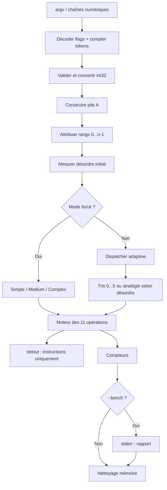
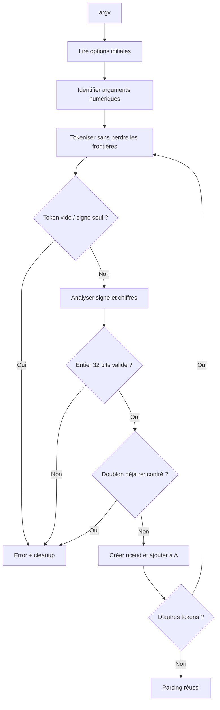
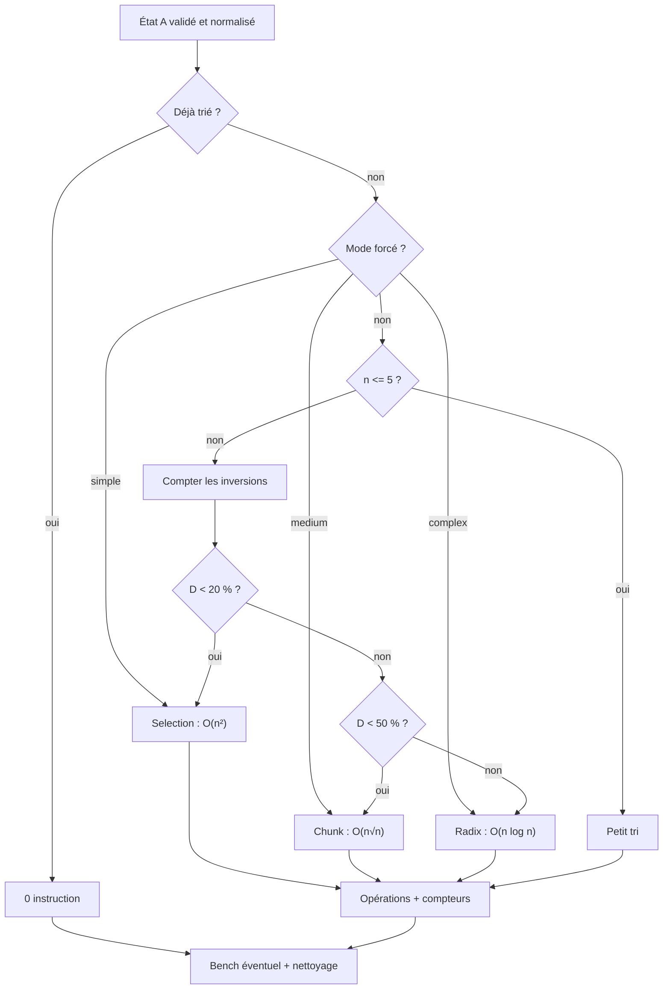

# PUSH_SWAP — PLAN DE BATAILLE A → Z V1.1

**École 42 — Guide de conception, d'implémentation, de tests et de correction**  
**Équipe : Tic & Tac | Version documentaire : 1.1 (post-audit du sujet officiel v1.2) | 24 novembre 2026**  
**Décision de conception : `--simple` = Selection Sort · `--medium` = Chunk Sort · `--complex` = LSD Binary Radix Sort · défaut = `--adaptive`.**

> **Statut du document.** Plan d'ingénierie détaillé du binôme, **révisé après confrontation au PDF officiel `Push_swap`, version 1.2, 22 pages**, transmis par l'équipe le 24 novembre 2026. Les règles explicitement établies par ce sujet sont désormais distinguées des **choix d'implémentation internes** et des points que le sujet laisse ouverts. Ce document reste un plan, **pas une preuve de validation d'un programme C encore à écrire**.
>
> **Principe directeur :** d'abord un programme *correct, déterministe, normé et testable* ; ensuite une optimisation *mesurée* sans détériorer ces garanties.

---

## Table des matières

1. [Décisions définitives et questions à verrouiller](#1-décisions-définitives-et-questions-à-verrouiller)
2. [Cahier des charges et critères d'acceptation](#2-cahier-des-charges-et-critères-dacceptation)
3. [Concepts indispensables et conventions](#3-concepts-indispensables-et-conventions)
4. [Architecture globale et arborescence](#4-architecture-globale-et-arborescence)
5. [Structures de données et propriété de la mémoire](#5-structures-de-données-et-propriété-de-la-mémoire)
6. [Parsing : stratégie et cas limites](#6-parsing--stratégie-et-cas-limites)
7. [Normalisation en rangs](#7-normalisation-en-rangs)
8. [Moteur des onze opérations](#8-moteur-des-onze-opérations)
9. [Petites piles : tris exacts de 0 à 5](#9-petites-piles--tris-exacts-de-0-à-5)
10. [`--simple` : Selection Sort complet](#10---simple--selection-sort-complet)
11. [`--medium` : Chunk Sort, version prouvable](#11---medium--chunk-sort-version-prouvable)
12. [`--complex` : LSD Binary Radix Sort](#12---complex--lsd-binary-radix-sort)
13. [`--adaptive` : désordre et stratégie](#13---adaptive--désordre-et-stratégie)
14. [`--bench` : instrumentation et sorties](#14---bench--instrumentation-et-sorties)
15. [Makefile, Norminette, outils de compilation](#15-makefile-norminette-outils-de-compilation)
16. [Plan de tests exhaustif et automatisé](#16-plan-de-tests-exhaustif-et-automatisé)
17. [Benchmarks et politique d'optimisation](#17-benchmarks-et-politique-doptimisation)
18. [Travail en binôme, Git et intégration](#18-travail-en-binôme-git-et-intégration)
19. [Calendrier à jalons et définition de « terminé »](#19-calendrier-à-jalons-et-définition-de--terminé-)
20. [Risques, pièges et procédures de diagnostic](#20-risques-pièges-et-procédures-de-diagnostic)
21. [Préparation de la soutenance / correction](#21-préparation-de-la-soutenance--correction)
22. [Décisions de conception, options et extensions](#22-décisions-de-conception-options-et-extensions)
23. [Annexes : traces, matrices, checklists, ressources et API](#23-annexes--traces-matrices-checklists-et-ressources)
24. [Référentiel de conformité au sujet officiel v1.2](#24-référentiel-de-conformité-au-sujet-officiel-v12)

---

# 1. Décisions définitives et questions à verrouiller

## 1.1. Le choix des stratégies

| Mode | Algorithme retenu | Borne visée en **instructions émises** | Pourquoi |
|---|---|---:|---|
| `--simple` | **Selection Sort**, extraction du minimum | `O(n²)` | Direct, général, très facile à démontrer et déboguer |
| `--medium` | **Chunk Sort**, groupes fixes de rangs | `O(n√n)` | Bon compromis ; construction d'une version à preuve explicite |
| `--complex` | **LSD Binary Radix Sort** sur rangs | `O(n log n)` | Borne garantie, stable et très peu de logique complexe |
| `--adaptive` | **Dispatcher** selon les inversions | dépend de la branche | Respect de la logique de désordre, sans quatrième tri |
| `--bench` | **Instrumentation transversale** | aucun mouvement supplémentaire | Statistiques sur `stderr` ; opérations seules sur `stdout` |

**Pourquoi pas Turk en `--complex` ?** Turk glouton optimise souvent très bien le nombre empirique de mouvements, mais une implémentation standard ne garantit pas à elle seule une borne générale `O(n log n)` en mouvements. Radix fournit une démonstration simple et sûre. Turk restera une **piste facultative de recherche**, non une dépendance du projet.

**Pourquoi Selection plutôt qu'Insertion en `--simple` ?** Extraction répétée des minimums + restauration est une stratégie quadratique simple. Les tris spécialisés pour 2–5 éléments restent une optimisation *distincte*, et non la définition du mode simple.

## 1.2. Décisions techniques

- **C** avec compilation `-Wall -Wextra -Werror`, et Norminette.
- **Deux piles**, `a` et `b` ; **sommet = tête**, fin = queue ; `b` vide au départ et à l'arrivée.
- **Liste doublement chaînée non circulaire**, avec `head`, `tail` et `size` dans chaque pile. Ce choix simplifie `rra`, `rrb`, les tests et le suivi des tailles. Une liste simplement chaînée est possible, mais inutile de changer une fois l'interface stabilisée.
- Nœuds alloués **une seule fois** pendant le parsing. Les opérations déplacent des nœuds, **sans allocation**.
- Chaque nœud conserve une `value` brute pour le parsing/diagnostic et un `rank` dans `[0, n-1]` pour les tris.
- **Primitives muettes** de modification des piles ; **opérations publiques** responsables de l'émission et du comptage. `rr`, `rrr`, `ss` comptent chacune pour **une** opération.
- Un **testeur indépendant** (par exemple Python) rejoue les instructions et vérifie les deux piles : l'auto-validation seule ne suffit pas.
- Le **bench** n'est ni un autre algorithme, ni une option modifiant les décisions de tri.
- **Pas de simulation de trois algorithmes** pour choisir le plus court dans le livrable initial ; pas de moteur de prédiction de coût sophistiqué sans besoin démontré.

## 1.3. État de conformité après lecture du sujet officiel v1.2

**Confirmé par le PDF officiel, pages 9–21 :** deux apprenants exactement ; `push_swap` ; `--simple`, `--medium`, `--complex`, `--adaptive` (par défaut), `--bench` ; 11 opérations ; complexités `O(n²)`, `O(n√n)`, `O(n log n)` en nombre d'opérations ; désordre par inversions mesuré **avant** le tri ; seuils adaptatifs **`D < 0,2`, `0,2 <= D < 0,5`, `D >= 0,5`** ; statistiques `--bench` sur **stderr** et opérations seules sur **stdout** ; erreur `Error\n` sur stderr ; benchmark 100/500 ; README obligatoire ; fonctions autorisées listées au §24 ; **checker en bonus**.

**Choix de l'équipe, non imposés par le PDF :** structure doublement chaînée, tableaux auxiliaires, acceptation de chiffres séparés dans des chaînes, ordre libre des flags, représentation interne des modes, format textuel exact des lignes `[bench]`, règles de détection des doublons de flags, structure des sous-dossiers.

**Point non spécifié textuellement :** la position imposée des flags par rapport aux nombres. Les exemples officiels placent les flags avant les données, mais ne déclarent pas que cet ordre est obligatoire. Par robustesse, nous proposons de reconnaître des flags isolés **avant ou après les nombres**, sans transformer un entier négatif en option. Cette tolérance est une décision technique, à tester.

**Vigilance majeure :** la **complexité** du Chunk de référence est justifiée, mais sa **performance** n'est pas automatiquement suffisante pour obtenir un bon résultat ; une optimisation mesurée sera nécessaire. Voir les mesures de simulation au §24.

**Règle d'autorité :** sujet officiel v1.2 > choix internes > ressources communautaires. Tout changement d'implémentation doit respecter le contrat précis du PDF.

---

# 2. Cahier des charges et critères d'acceptation

## 2.1. Entrée et sortie

**Entrée :** liste finie d'entiers signés 32 bits distincts ; `a` contient les valeurs dans l'ordre reçu (premier argument numérique = sommet), `b` vide.

**Sortie normale :** uniquement des lignes d'instructions parmi :

`sa`, `sb`, `ss`, `pa`, `pb`, `ra`, `rb`, `rr`, `rra`, `rrb`, `rrr`.

**État final :** `a` strictement croissante du sommet vers le bas, avec tous les éléments d'origine ; `b` vide.

**Entrée déjà triée :** aucune instruction sur stdout, même en mode forcé. Avec `--bench`, les mesures restent sur stderr (sous réserve de la présentation requise dans le sujet).

**Entrée invalide :** `Error\n` sur `stderr` et aucune instruction sur stdout ; ressources libérées avant sortie. Le code de retour non nul est recommandé, sous réserve du sujet.

## 2.2. Interfaces de lancement proposées

```bash
./push_swap 3 2 1
./push_swap "3 2 1"
./push_swap "3 2" 1
./push_swap --simple 3 2 1
./push_swap --medium 3 2 1
./push_swap --complex 3 2 1
./push_swap --adaptive 3 2 1
./push_swap --bench --medium 4 67 3 87 23
./push_swap --complex --bench 5 4 3 2 1
```

Le sujet v1.2 montre surtout des options en début de ligne, sans prescrire explicitement leur position. **Choix robuste recommandé :** accepter les options isolées avant **ou** après les nombres, sans jamais confondre `-3` et un flag ; autoriser `--bench` à accompagner un seul sélecteur. Les chaînes contenant plusieurs nombres restent une tolérance recommandée, non explicitement imposée par l'exemple officiel.

## 2.3. Seuils de performance officiels v1.2

Les paliers ci-dessous figurent **explicitement page 18, section VI.6** du PDF officiel. Ils s'appliquent à des nombres aléatoires et utilisent des comparaisons **strictes** (« less than »).

| Taille | Réussite rapportée | Bon niveau rapporté | Excellent rapporté |
|---|---:|---:|---:|
| 100 | moins de 2 000 | moins de 1 500 | moins de 700 |
| 500 | moins de 12 000 | moins de 8 000 | moins de 5 500 |

**Point technique majeur :** Radix binaire sur les rangs `0…499`, sans sortie précoce en cours d'algorithme, émet **6 784** opérations pour `n=500` ; sur les rangs `0…99`, **1 084** pour `n=100`. C'est un **nombre exact dérivé de l'algorithme**, pas une garantie d'excellence en score. Une variante peut en émettre moins, mais devra être à nouveau prouvée et testée.

## 2.4. Grille de validation interne

Une fonctionnalité est **terminée** seulement quand :

1. Elle satisfait son contrat (entrées, sorties, état des piles).
2. Elle est testée indépendamment, y compris ses cas limites.
3. Elle ne fuit pas de mémoire et n'accède pas hors limites.
4. Elle compile proprement et passe Norminette.
5. Elle est comprise et expliquée **par les deux développeurs**.
6. Les résultats de test figurent dans une trace reproductible (`seed`, commande, commit, compteur).

---

# 3. Concepts indispensables et conventions

## 3.1. Pourquoi les « trois classes » concernent les opérations

Dans `push_swap`, la mesure centrale est la **longueur de la séquence produite**. Le nombre de comparaisons C utilisées pour chercher un minimum ou compter des inversions ne correspond pas à une instruction `sa/pb/ra/...`.

- `O(n²)` : croissance bornée par une constante fois `n²`.
- `O(n√n)` : croissance bornée par une constante fois `n√n`.
- `O(n log n)` : croissance bornée par une constante fois `n log n`.

Il faut distinguer : **complexité de la séquence d'opérations**, **temps CPU du programme** (recherches C, allocation, normalisation) et **mémoire auxiliaire**. Le sujet peut exiger des justifications de plusieurs de ces dimensions ; le document les sépare.

Un résultat à `n=500` ne **prouve pas** une complexité asymptotique. Inversement, `O(n log n)` ne garantit pas moins d'opérations que `O(n√n)` pour une taille donnée, à cause des constantes.

## 3.2. Conventions obligatoires entre binômes

- `a.head` / `b.head` : sommet, index logique 0.
- `a.tail` / `b.tail` : dernier élément.
- `node.value` : entier signé d'origine ; `node.rank` : entier de 0 à n−1.
- `size` : nombre réel de nœuds, toujours cohérent.
- Les fonctions de lecture (`find_min`, `index_of`, `is_sorted`) sont **sans effet de bord**.
- Les fonctions de modification des piles **n'impriment rien** si elles sont de bas niveau.
- Un algorithme ne manipule **jamais directement** les pointeurs `next/prev` : il demande `ps_pb`, `ps_ra`, etc.
- Une fonction effectue une responsabilité ; les noms sont explicites et conformes à la Norme.
- Le benchmark mesure chaque instruction au moment exact où elle est produite, pas par reconstruction d'un texte a posteriori.

## 3.3. Invariants globaux

Ces propositions doivent rester vraies après chaque opération :

1. `a.size + b.size == n_initial`.
2. Chaque nœud d'origine apparaît exactement **une fois** dans l'union des deux piles.
3. Dans chaque pile : `head->prev == NULL` et `tail->next == NULL` si non vide.
4. Pile vide : `head == NULL`, `tail == NULL`, `size == 0`.
5. Les liens `next` et `prev` sont réciproques.
6. `rank` ne change jamais après normalisation, pas de doublon de rang.
7. Les seuls changements de piles après initialisation sont les **11 opérations officielles**.
8. Le nombre d'instructions réellement émises égale la somme des onze compteurs.

**Interprétation des exemples :** les listes affichées horizontalement vont du **sommet à gauche** vers le **bas à droite** : `A = [3, 1, 2]` signifie sommet `3`.

---

# 4. Architecture globale et arborescence

## 4.1. Diagramme d'ensemble



## 4.2. Arborescence de départ recommandée

```text
push_swap/
├── Makefile
├── README.md                    # Présentation synthétique du projet
├── include/
│   ├── push_swap.h              # t_app, t_stack, t_node, t_options
│   ├── ps_ops.h                 # 11 opérations publiques et primitives
│   └── ps_sort.h                # Contrats des trois stratégies
├── src/
│   ├── main.c
│   ├── parsing/
│   │   ├── parse_options.c
│   │   ├── parse_tokens.c
│   │   ├── parse_int.c
│   │   └── parse_unique.c
│   ├── stack/
│   │   ├── stack_create.c
│   │   ├── stack_free.c
│   │   ├── stack_links.c
│   │   └── stack_queries.c
│   ├── rank/
│   │   └── rank_normalize.c
│   ├── ops/
│   │   ├── ops_swap.c
│   │   ├── ops_push.c
│   │   ├── ops_rotate.c
│   │   ├── ops_revrotate.c
│   │   └── ops_emit.c
│   ├── sort/
│   │   ├── sort_small.c
│   │   ├── sort_simple.c
│   │   ├── sort_medium.c
│   │   ├── sort_medium_restore.c
│   │   └── sort_radix.c
│   ├── adaptive/
│   │   ├── disorder.c
│   │   └── choose_strategy.c
│   └── bench/
│       ├── bench_counters.c
│       └── bench_report.c
├── tests/                       # Non liés au binaire livré
│   ├── test_operations.py
│   ├── test_exhaustive.py
│   ├── test_invalid.sh
│   ├── test_bench.py
│   └── cases/
├── tools/                       # Générateurs / scripts hors compilation
│   └── benchmark.py
└── docs/
    ├── PLAN_A_Z.md              # Copie de ce document
    ├── decisions.md             # Choix modifiés et justification
    ├── algorithms.md            # Résultats de tests / optimisations
    └── evaluations.md           # Répétition de soutenance
```

**L'arborescence est une proposition, pas un quota de fichiers.** Ne créez pas de fichiers vides « pour coller au plan ». Ajustez selon la limite de cinq fonctions par `.c`, les fonctions réellement écrites et la taille normée. Évitez une architecture de 50–60 modules avant d'avoir une version fonctionnelle.

## 4.3. Contrats de module

| Module | Reçoit | Produit | Ne doit jamais faire |
|---|---|---|---|
| Parsing | `argc, argv` | flags, nœuds valides | émettre une instruction |
| Stack | pile, nœud | liens/tailles cohérents | imprimer un mouvement |
| Rank | nœuds originaux | rangs uniques 0…n−1 | changer l'ordre initial |
| OPS | deux piles | mouvement + ligne + compteur | allouer un nœud |
| Simple | `t_app` | tri via OPS | manipuler les liens |
| Medium | `t_app` | tri via OPS | casser les bornes de chunks |
| Radix | `t_app` | tri via OPS | comparer les valeurs brutes |
| Adaptive | rangs originaux | mode sélectionné | modifier les piles |
| Bench | compteurs, désordre | rapport `stderr` | écrire sur stdout |
| Tests | binaire + données | OK / KO + trace | masquer les échecs |

---

# 5. Structures de données et propriété de la mémoire

## 5.1. Types proposés (schéma, à adapter à la Norminette)

```c
typedef struct s_node
{
	int			value;
	int			rank;
	struct s_node	*next;
	struct s_node	*prev;
}   t_node;

typedef struct s_stack
{
	t_node	*head;
	t_node	*tail;
	int		size;
}   t_stack;

typedef enum e_mode
{
	MODE_ADAPTIVE,
	MODE_SIMPLE,
	MODE_MEDIUM,
	MODE_COMPLEX
}   t_mode;

typedef struct s_options
{
	t_mode	mode;
	int		bench;
}   t_options;

typedef struct s_stats
{
	long	counts[11];
	long	total;
	double	disorder;
	t_mode	used_mode;
}   t_stats;

typedef struct s_app
{
	t_stack		a;
	t_stack		b;
	t_options	options;
	t_stats		stats;
	int			initial_size;
}   t_app;
```

Ce sont des **types d'interface**, pas un programme complet à copier sans réflexion. Les membres des structures sont là pour clarifier les responsabilités. Vérifier la Norminette sur les typedefs et éviter les dépendances circulaires entre headers.

`used_mode` enregistre ce qui a **effectivement tourné**, alors que `options.mode` enregistre le mode **demandé**. Cette distinction évite un benchmark mensonger sur les petites piles optimisées.

## 5.2. Propriété mémoire

- `parse` crée les nœuds et cède leur propriété à `t_app`.
- `stack_push` détache et déplace un **nœud existant** : jamais de `malloc`, jamais de `free`.
- La normalisation peut utiliser un tableau auxiliaire temporaire ; celui-ci est libéré immédiatement.
- `app_cleanup` libère tous les nœuds de A et B, une fois chacun.
- Sur échec du parsing à la valeur `i`, on libère les `i` nœuds déjà créés, ainsi que toute allocation auxiliaire.
- Un pointeur de pile ne doit jamais être utilisé après libération du nœud.

## 5.3. Contrats de modification des liens

Écrire des fonctions privées pour :

1. `detach_head(stack)` : enlève le sommet, retourne le nœud ou `NULL` ; met `next/prev` à `NULL`.
2. `attach_head(stack, node)` : insère ce nœud au sommet ; ajuste queue si vide.
3. `detach_tail(stack)` et `attach_tail(stack,node)` : pour les rotations.
4. `swap_heads(stack)` : échange seulement les deux premières positions, en tenant compte du cas taille 2.

**Tests critiques :** taille 0, 1, 2, 3 ; détacher un élément unique ; rotation de taille 2 ; mélange de `push` et de `reverse_rotate`. Le cas taille 2 est à l'origine d'une grande proportion des bugs de liens doubles.

## 5.4. Pourquoi pas un tableau comme pile ?

Un tableau simplifie la vérification mémoire mais une rotation peut demander un décalage de `O(n)` en CPU ; la liste doublement chaînée permet de changer quelques pointeurs. Comme **le critère de notation est le nombre d'opérations émises**, les deux sont possibles. Le choix de la liste favorise l'efficacité interne et se prête à l'architecture retenue. **N'alternez pas entre deux représentations** au milieu du projet.

---

# 6. Parsing : stratégie et cas limites

## 6.1. Pipeline exact



## 6.2. Ordre des options

La **présence** des cinq flags est requise par le sujet. Leur **position** par rapport aux nombres n'est pas explicitement prescrite. Afin d'éviter un rejet inutile, notre parser reconnaîtra les flags isolés où qu'ils soient dans `argv`. Proposition : `--simple`, `--medium`, `--complex`, `--adaptive` sont **mutuellement exclusifs** ; `--bench` peut être associé à l'un d'eux ; sans mode explicite : `MODE_ADAPTIVE`.

- `--simple --bench 3 2 1` : valide.
- `--bench --simple 3 2 1` : valide.
- `--bench 3 2 1` : mode adaptive.
- `--simple --complex 3 2 1` : **erreur** (deux stratégies).
- `--simple --simple 3 2 1` : **erreur** (doublon, décision interne, à confirmer).
- `3 2 1 --bench` : **accepté par tolérance robuste**, même si les exemples officiels placent habituellement les flags avant les données.
- `-3` : **entier négatif**, pas une option.
- `--unknown`, `--`, `--benchmarks` : **erreur**.

## 6.3. Détection des entiers

Un token numérique valide suit : `['+'|'-']? [0-9]+` et doit représenter un entier de `[-2147483648, 2147483647]`.

L'algorithme de conversion doit :

1. Identifier le signe (`+`, `-` ou absent).
2. Exiger **au moins un chiffre**.
3. Pour chaque caractère : vérifier qu'il est entre `'0'` et `'9'`.
4. Contrôler **avant** l'opération `acc = acc * 10 + digit` que `acc <= (limit - digit) / 10`, avec `limit=2147483647` pour positif et `2147483648` pour négatif ; utiliser un type suffisamment large pour `acc`.
5. Produire `INT_MIN` sans faire `-INT_MIN` : convertir seulement après la validation de la magnitude, avec une branche dédiée si nécessaire.
6. Rejeter les caractères résiduels (`42a`, `3.5`, `4-2`, `++4`).

**Ne pas utiliser `ft_atoi` seul** pour valider : ses conversions silencieuses et les débordements ne répondent pas au contrat.

## 6.4. Tokens et espaces

- Préférer un scanner qui parcourt chaque `argv[i]` et sépare les tokens sur les **espaces autorisés par le sujet**.
- Une chaîne contenant seulement des espaces ne doit pas être interprétée comme une liste valide de taille zéro sans décision explicite.
- Choix robuste proposé : gérer espace et tabulation ASCII comme séparateurs **si autorisés** ; autrement n'accepter que `' '`.
- Ne jamais inventer un `0` pour un token vide.
- Conserver l'ordre des tokens sur plusieurs chaînes argument : `"5 2" "8 1"` correspond à `5,2,8,1`.
- Deux espaces consécutifs à l'intérieur d'une chaîne sont admis **uniquement si** le sujet autorise des espacements arbitraires ; sinon rejet. Ce point est contractuel, pas algorithmique.

## 6.5. Unicité

Deux valeurs sont doublons si leurs **valeurs numériques** sont identiques, indépendamment de leur texte : `0`, `+0`, `-0`, `0000` sont la **même valeur**. Pour 500 nombres, une recherche linéaire sur les nœuds précédents est acceptable en CPU, même si elle est `O(n²)` : aucune opération `push_swap` n'est émise pendant le parsing.

## 6.6. Matrice de validation obligatoire

| Entrée / cas | Résultat attendu |
|---|---|
| `./push_swap` | stdout et stderr vides |
| `1`, `1 2 3`, `-2 0 5` | aucun mouvement |
| `2 1` | tri avec 1 instruction, typiquement `sa` |
| `0 -0` | `Error` (doublon) |
| `+0 0`, `01 1` | `Error` (doublon) |
| `2147483647 -2147483648` | accepté |
| `2147483648`, `-2147483649` | `Error` |
| `99999999999999999999999999` | `Error` sans overflow C |
| `+`, `-`, `1a`, `3.14`, `4-3` | `Error` |
| `""`, `" "`, `"3" "" "1"` | à rejeter selon le choix contractuel |
| `--simple --complex 3 2` | `Error` |
| `--bench --medium 3 2 1` | instructions stdout, rapport stderr |
| `"1 2" "3 4"` | ordre préservé, sortie vide |

**Astuce de test :** vérifier séparément les octets de stdout, stderr et le code de retour, et pas seulement si « le programme segfault ou non ».

---

# 7. Normalisation en rangs

## 7.1. Définition

La normalisation remplace chaque valeur par sa **position dans l'ordre croissant des valeurs distinctes**, en partant de zéro.

Exemple :

```text
Valeurs originales (A, sommet à gauche) : [ 42, -10, 100, 7 ]
Valeurs triées auxiliaires           : [ -10, 7, 42, 100 ]
Rangs attribués aux nœuds de A       : [  2, 0,  3, 1 ]
```

Le tableau auxiliaire n'est **jamais** considéré comme une opération de tri des piles : on ne modifie pas A en le triant directement. Les mouvements ultérieurs passent toujours par les 11 opérations.

## 7.2. Implémentation conseillée

1. Copier les `n` valeurs dans un tableau temporaire.
2. Trier ce tableau auxiliaire (tri par sélection acceptable pour `n<=500`, ou tri fusion si disponible/autorisé).
3. Pour chaque nœud de A, trouver sa valeur dans le tableau trié et inscrire son index dans `rank`.
4. Libérer le tableau temporaire.

Alternative : calculer chaque rang comme le nombre de valeurs strictement inférieures en parcourant les nœuds. C'est `O(n²)` en CPU, mais économe en allocations ; valide pour des tailles modestes. **Choisir une seule méthode et tester les extrêmes INT_MIN/INT_MAX.**

## 7.3. Postconditions

- `rank` est dans `[0, n-1]` pour chaque nœud.
- Tous les rangs sont différents.
- Pour tout couple, `value_i < value_j` si et seulement si `rank_i < rank_j`.
- La séquence des nœuds n'a pas changé pendant la normalisation.
- La pile A est triée par valeurs si et seulement si elle est triée par rangs.

---

# 8. Moteur des onze opérations

## 8.1. Sémantique complète

| Instruction | Effet | Précondition d'effet | Exemple (sommet à gauche) |
|---|---|---|---|
| `sa` | inverse les deux premiers de A | `size_a >= 2` | `[1,2,3] → [2,1,3]` |
| `sb` | inverse les deux premiers de B | `size_b >= 2` | `[4,5] → [5,4]` |
| `ss` | `sa` et `sb` simultanément | une des piles peut être non échangeable | opération unique |
| `pa` | sommet de B → sommet de A | `size_b >= 1` | `A=[2] B=[1,3] → A=[1,2] B=[3]` |
| `pb` | sommet de A → sommet de B | `size_a >= 1` | `A=[1,2] B=[3] → A=[2] B=[1,3]` |
| `ra` | sommet de A → bas de A | `size_a >= 2` | `[1,2,3] → [2,3,1]` |
| `rb` | sommet de B → bas de B | `size_b >= 2` | idem pour B |
| `rr` | `ra` et `rb` simultanément | effet selon taille des piles | opération unique |
| `rra` | bas de A → sommet de A | `size_a >= 2` | `[1,2,3] → [3,1,2]` |
| `rrb` | bas de B → sommet de B | `size_b >= 2` | idem pour B |
| `rrr` | `rra` et `rrb` simultanément | effet selon taille des piles | opération unique |

Sémantique standard : une sous-opération impossible faute d'éléments ne modifie pas sa pile. **Politique locale recommandée** : ne pas émettre de ligne si l'opération demandée n'a d'effet dans aucune pile ; pour une opération combinée, émettre une seule ligne si au moins une sous-opération a un effet. Ceci produit une sortie plus courte et reste reproductible au checker.

## 8.2. Architecture des fonctions OP

```text
ps_ra(app)
    ├── low_rotate(&app->a)         # pure modification de liens
    └── emit_and_count(app, OP_RA)   # si effet réel

ps_rr(app)
    ├── low_rotate(&app->a)         # pas d'impression
    ├── low_rotate(&app->b)         # pas d'impression
    └── emit_and_count(app, OP_RR)   # UNE ligne, UN compteur
```

Ne pas implémenter `ps_rr()` en appelant `ps_ra()` puis `ps_rb()` : cela produirait deux instructions au lieu d'une. Même règle pour `ss` et `rrr`.

## 8.3. Compteurs

Réserver une énumération stable : `OP_SA`, `OP_SB`, `OP_SS`, `OP_PA`, `OP_PB`, `OP_RA`, `OP_RB`, `OP_RR`, `OP_RRA`, `OP_RRB`, `OP_RRR`. La table de noms associée doit respecter cet ordre. Le compteur `total` doit être exactement égal à la somme des onze compteurs.

**Validation indépendante** : pour chaque opération et pour des tailles 0,1,2,3, comparer l'état final du C avec un simulateur de piles Python. Vérifier que `rr` n'écrit qu'une ligne et que `pb` puis `pa` restaure l'état d'origine (lorsque la séquence est applicable).

---

# 9. Petites piles : tris exacts de 0 à 5

Le traitement spécifique des petites piles réduit considérablement les opérations. Il est **distinct** du tri Selection Sort général.

## 9.1. Cas élémentaires

- `n=0` ou `n=1` : ne rien écrire.
- `n=2` : si `rank(head) > rank(head.next)`, `sa`, sinon rien.
- `n=3` : comparer les rangs des trois nœuds et appliquer un cas de la table ci-dessous.

## 9.2. Table exacte des six permutations de trois éléments

Les chiffres 0,1,2 représentent **l'ordre relatif des trois valeurs présentes**, même si leurs rangs globaux sont 5,8,12.

| A au départ | Opérations | A à l'arrivée |
|---|---|---|
| `[0,1,2]` | aucune | `[0,1,2]` |
| `[0,2,1]` | `sa`, `ra` | `[0,1,2]` |
| `[1,0,2]` | `sa` | `[0,1,2]` |
| `[1,2,0]` | `rra` | `[0,1,2]` |
| `[2,0,1]` | `ra` | `[0,1,2]` |
| `[2,1,0]` | `sa`, `rra` | `[0,1,2]` |

Cette table trie chaque permutation en **au plus deux opérations**. La fonction doit identifier les cas par comparaisons, pas nécessairement construire littéralement un tableau d'index.

## 9.3. Quatre nombres

1. Repérer le minimum dans A.
2. Le remonter par `ra` ou `rra` (distance la plus courte).
3. `pb` : le minimum est désormais seul dans B.
4. Trier les trois éléments restants dans A.
5. `pa` : le minimum revient en tête de A.

**Invariant avant le dernier `pa` :** A est croissante et `B.head` est inférieur à tous les éléments de A.

## 9.4. Cinq nombres

1. Extraire le minimum dans B.
2. Extraire le minimum **parmi les quatre restants** dans B.
3. Trier les trois éléments de A.
4. Exécuter deux `pa`.

**Attention à l'ordre :** après les deux `pb`, B contient `[second_min, first_min]`. Les deux `pa` donnent `[first_min, second_min, ...trois plus grands triés]`.

## 9.5. Politique pour les modes forcés

**Recommandation confirmée :** en **adaptive**, utiliser le petit tri pour `n<=5` si la branche de complexité correspondante reste documentée et que le benchmark annonce la bonne stratégie. En **mode forcé**, exécuter réellement le moteur demandé, y compris sur les petites piles : le PDF dit qu'un sélecteur doit fonctionner **quel que soit le nombre d'éléments ou le désordre**. Une optimisation petite taille intégrée dans le moteur forcé peut être admissible, mais ne doit pas masquer la stratégie annoncée. Cela rend le comportement de `--bench` transparent.

Une fois les exigences exactes confirmées, vous pourrez mutualiser les petits tris pour tous les modes sans changer leur classe asymptotique. **Ne pas afficher « radix » si c'est le petit tri qui s'est réellement exécuté**, sauf si vous documentez explicitement un moteur `radix + small-case fast path`.

---

# 10. `--simple` : Selection Sort complet

## 10.1. Intuition

À chaque tour, identifier le plus petit élément restant, le placer au sommet de A, puis l'envoyer au sommet de B. À la fin, les plus petits ont été poussés **dans l'ordre croissant** ; B les contient donc **dans l'ordre décroissant**. Les `pa` reconstruisent A dans l'ordre croissant.

Exemple avec rangs :

```text
Départ :             A [3, 1, 4, 0, 2]   B []
Extraire 0 (pb) :    A [2, 3, 1, 4]      B [0]      # A a subi rotation(s)
Extraire 1 (pb) :    A [4, 2, 3]         B [1, 0]
Trier les trois :    A [2, 3, 4]         B [1, 0]
pa :                 A [1, 2, 3, 4]      B [0]
pa :                 A [0, 1, 2, 3, 4]   B []
```

La position exacte d'A après les rotations dépend de la direction utilisée, mais l'invariant de B reste le même.

## 10.2. Pseudocode de référence

```text
simple_sort(app):
    si A est déjà triée: retourner
    tant que size(A) > 3:
        p = position_du_minimum(A)
        faire_remonter_par_chemin_court(A, p)
        pb
    trier_les_3_ou_moins_de_A
    tant que B n'est pas vide:
        pa
```

Pour une version intégralement uniforme de Selection, on peut vider A jusqu'à 0, puis tout récupérer ; la version qui laisse trois éléments exploite le petit tri pour gagner des mouvements. Les deux sont `O(n²)`.

## 10.3. Calcul du chemin de rotation

Pour une pile de longueur `m` et un élément à la position `p` (0 = sommet) :

- Nombre de `ra` nécessaires : `p`.
- Nombre de `rra` nécessaires : `m - p`.
- Si `p <= m/2`, privilégier `ra`; sinon `rra`.
- Ne rien faire si `p == 0`.

Les `size` et `p` sont recalculés **après chaque extraction**, jamais réutilisés à partir de l'état précédent.

## 10.4. Invariant et preuve de correction

Au début de chaque itération :

1. B contient exactement les minimums déjà extraits, avec le **plus grand** de ces minimums au sommet.
2. Tous les éléments restants de A sont **plus grands** que tous les éléments de B.
3. Le prochain minimum de A est déplacé dans B sans perdre ni dupliquer de nœud.

À la fin de la phase d'extraction : A contient trois plus grands éléments, que `sort_three` classe ; B contient les autres en ordre décroissant. Chaque `pa` ajoute en tête d'A un élément plus petit que tous ceux déjà dans A. Par induction, A est croissante à la fin.

## 10.5. Complexité

Pour chaque extraction d'une pile de taille `m`, coût de déplacement au plus `floor(m/2)` rotations + `pb`. En sommant pour `m = n, n-1, ..., 4`, le coût est en `O(n²)`. Les derniers trois éléments coûtent au plus deux opérations, et les retours coûtent `n-3` opérations `pa`. **Borne totale : `O(n²)` en instructions.** Recherche des minimums en C : elle aussi `O(n²)` en comparaisons, sans compter comme instructions.

## 10.6. Optimisations sûres

- Tester la pile déjà triée **avant** d'entrer dans le tri.
- Utiliser le chemin le plus court `ra/rra`.
- Conserver une fin à trois éléments plutôt que vider entièrement A.
- Envisager un tri spécialisé de 4–5 pour réduire le maximum, à partir des tests exhaustifs.
- Ne pas ajouter de code complexe de « prédiction » à ce module.

## 10.7. Contrat de validation Simple

- [ ] Fonctionne sur toutes les 120 permutations de cinq éléments et les 720 de six.
- [ ] Fonctionne sur 100 et 500 nombres **en mode forcé** (même si les opérations sont nombreuses).
- [ ] Pile B vide, ordre strictement croissant dans A.
- [ ] La longueur de séquence ne dépasse pas une borne quadratique raisonnable.
- [ ] Les deux développeurs savent démontrer la correction.

---

# 11. `--medium` : Chunk Sort, version prouvable

> **Décision d'ingénierie importante :** construire une **version de référence correcte et rigoureusement `O(n√n)`** en instructions, puis **une version optimisée** après instrumentation. Beaucoup de descriptions de Chunk Sort affirment `O(n√n)` uniquement parce qu'elles choisissent `√n` chunks : **ce n'est pas une preuve suffisante** si l'on effectue ensuite des recherches de maxima dans B avec des rotations pouvant traverser toute la pile.

## 11.1. Principes

On travaille avec les rangs `[0, n-1]` :

- Taille d'un groupe (chunk) : `c = ceil(sqrt(n))`, entière, toujours `>= 1`.
- Nombre de groupes : `k = ceil(n/c)`.
- Chunk `j` : intervalle `[j*c, min((j+1)*c, n))`.
- On traite les chunks **du plus petit vers le plus grand**.
- Pendant la première phase, on utilise uniquement **`ra` pour balayer A** et `pb` pour transférer les éléments qui appartiennent au chunk courant.
- **Interdiction initiale de `rb`/`rrb` pendant le transfert :** cela garantit que les chunks restent **contigus dans B**.

Pour `n = 10`, `c = 4` (arrondi supérieur de `sqrt(10)`), les chunks sont `[0..3]`, `[4..7]`, `[8..9]`.

## 11.2. Phase A → B : balayage par groupes

```text
pour start = 0, c, 2c, ... < n:
    end = min(start + c, n)
    left = end - start
    tant que left > 0:
        si start <= A.head.rank < end:
            pb
            left--
        sinon:
            ra
```

Chaque chunk est entièrement transféré avant le suivant. Les valeurs non concernées tournent dans A et restent disponibles pour les chunks suivants.

### Exemple visuel

```text
Rangs initiaux : A [6, 1, 8, 3, 0, 9, 5, 2, 7, 4]   B []

Chunk 0 : {0,1,2,3} transféré par pb/ra
    A contient une permutation de {4,5,6,7,8,9}
    B contient une permutation de {0,1,2,3}

Chunk 1 : {4,5,6,7} transféré par pb/ra
    A contient {8,9}
    B [valeurs du chunk 1 | valeurs du chunk 0]

Chunk 2 : {8,9} transféré par pb/ra
    A []
    B [valeurs du chunk 2 | chunk 1 | chunk 0]
```

**Invariant fondamental :** les nœuds de chaque chunk forment **un bloc contigu** de B. Les chunks d'indices supérieurs se situent au-dessus des chunks d'indices inférieurs. **Ne pas utiliser de rotations de B dans cette première version** : elles invalideraient cet invariant.

## 11.3. Phase B → A : récupérer les maxima sans casser les blocs

Problème subtil : une simple recherche du maximum dans B suivie de `rb` ou `rrb`, puis `pa`, peut faire passer des morceaux du chunk courant **derrière des chunks plus petits**. La prochaine recherche n'est alors plus bornée à `c` positions : la preuve de complexité s'effondre.

**Solution de référence : remettre B dans son orientation canonique après chaque extraction.**

Pour le chunk supérieur en cours de traitement :

1. Chercher le **maximum du chunk courant** parmi ses `left` éléments du haut de B. Noter sa position `p` (à partir de 0).
2. Exécuter `rb` exactement `p` fois : le maximum arrive au sommet de B.
3. Exécuter `pa` : il est placé sur A.
4. Exécuter `rrb` exactement `p` fois : les autres éléments de B retrouvent **le même ordre relatif qu'avant**, moins le maximum retiré.
5. Répéter jusqu'à épuisement du chunk, puis passer au chunk suivant.

### Exemple essentiel : restauration de B

```text
B canonique :     [7, 5, 6, 3, 2, 1, 0]
                   ^ chunk courant {5,6,7} ; cible 7 déjà au sommet

Après pa(7) :     [5, 6, 3, 2, 1, 0]
Cible 6 : position 1
rb :              [6, 3, 2, 1, 0, 5]
pa :              [3, 2, 1, 0, 5]
rrb :             [5, 3, 2, 1, 0]  <-- ordre canonique restauré

Le chunk suivant ne se mélange jamais aux autres groupes.
```

**Version un peu optimisée mais toujours prouvable :** au lieu de `rb` `p` fois et `rrb` `p` fois, on peut choisir le chemin inverse si `size_b - p < p` : avant `pa`, faire `rrb` **`size_b-p` fois** ; après le `pa`, faire `rb` **`size_b-p-1` fois** (attention : la pile a perdu un nœud). **Les nombres de rotations aller et retour sont donc différents dans ce cas.** Dans les deux cas, on restaure l'ordre relatif de B, avec un coût `O(c)` lorsque le candidat est dans le chunk du sommet.

### Pseudocode B → A

```text
pour start = start_du_plus_grand_chunk; start >= 0; start -= c:
    end = min(start+c, n)
    left = end-start
    tant que left > 0:
        p = position_du_maximum_parmi_les_left_premiers(B)
        repeter p fois: rb
        pa
        repeter p fois: rrb
        left--
```

**Note pratique :** utiliser la taille réelle de B pour calculer le chemin inverse ; faire `rrb` sur B après le `pa`, pas avant, et restaurer exactement `p` rotations. Le programme C doit utiliser des boucles `while`, et les noms `left`, `start`, etc. ne sont que des pseudonymes.

## 11.4. Preuve de correction

1. Après A → B, A est vide ; B contient une partition en blocs contigus de rangs, avec le **plus grand chunk au sommet**.
2. Pendant B → A, chaque extraction sélectionne le plus grand rang encore présent du chunk supérieur, sans mélanger le reste des blocs grâce à la rotation inverse de restauration.
3. On extrait donc les rangs dans l'ordre global **`n−1, n−2, ..., 0`**.
4. Chaque `pa` les insère en tête d'A ; après la dernière extraction, A vaut `[0,1,...,n−1]`, B est vide.

## 11.5. Preuve de complexité `O(n√n)` en instructions

Soit `c = ceil(sqrt(n))` et `k = ceil(n/c)` :

**Phase A → B.** Pendant un chunk, le balayage par `ra` rencontre au plus une fois chaque élément de A qui n'appartient pas au chunk avant d'avoir expulsé toutes ses valeurs cibles. Il y a donc au plus `n` rotations `ra` par chunk, plus un `pb` pour chaque nombre. **Borne : `n*k + n` instructions**, donc `O(n√n)`.

**Phase B → A.** Pour chaque maximum, sa position `p` dans le chunk courant est **strictement inférieure à `c`** ; on émet au maximum `p` `rb`, 1 `pa`, puis `p` `rrb`. Soit **`2(c−1)+1` instructions par élément**. Sur `n` éléments : `n(2c−1)`, soit `O(n√n)`.

**Total :**

```text
T(n) <= n*k + n + n*(2c-1)
     <= n*ceil(n/ceil(sqrt(n))) + 2*n*ceil(sqrt(n))
     = O(n*sqrt(n))
```

Cette borne est **en nombre d'instructions**, indépendamment des positions initiales. Les comparaisons C pour trouver un maximum peuvent ajouter du temps CPU et doivent être distinguées de cette borne.

**Limite de performance :** cette version conservatrice peut émettre **nettement plus de mouvements** qu'un Chunk Sort agressivement optimisé. Elle constitue un **socle prouvé**, pas la promesse d'un score excellent à 500. Ne pas remplacer sa preuve par un benchmark.

## 11.6. Pourquoi les versions optimisées sont délicates

Optimisations tentantes :

- Tourner B après certains `pb` pour rapprocher les grands maxima du sommet.
- Déplacer directement le prochain maximum depuis une position quelconque de B avec `rb/rrb` sans restauration.
- Utiliser une fenêtre glissante inspirée de **K Sort**.
- Rechercher le « prochain bon élément » de A dans les deux directions.

Ces idées peuvent **réduire fortement le coût pratique**, mais risquent de casser les blocs contigus ou d'introduire des déplacements de longueur `O(n)` répétés `O(n)` fois. Si vous en implémentez une, il faudra :

1. Formaliser un **nouvel invariant** explicite.
2. Refaire la **démonstration du nombre maximal de mouvements** ou indiquer honnêtement que la version n'a qu'une preuve empirique.
3. Lancer les **mêmes seeds** contre la version de référence.
4. Refuser toute amélioration qui rend un tri parfois incorrect.

Ne promettez pas `O(n√n)` pour une variante « parce qu'il y a √n chunks ». La taille des groupes ne borne pas à elle seule les mouvements.

## 11.7. Ajustement de taille des chunks

La valeur `c = ceil(sqrt(n))` donne la borne théorique souhaitée. Pour optimiser les constantes, vous pourrez essayer `c = ceil(alpha * sqrt(n))` avec `alpha` fixe, par exemple `0,75`, `1`, `1,25`, `1,5`, **à condition** que le nombre de chunks et la taille des groupes restent chacun `Theta(sqrt(n))` lorsque n grandit. En pratique, utiliser des calculs entiers pour éviter les écarts d'arrondi et tester les frontières `n=c²`, `n=c²+1`, `n=c²−1`.

**Important :** une taille de chunk fixe (par exemple 20 quel que soit `n`) ne suffit pas à définir une famille asymptotique `O(n√n)` pour des n arbitraires.

## 11.8. Critères de validation Medium

- [ ] Aucun `rb` pendant A → B dans la version de référence.
- [ ] Tous les rangs d'un chunk restent contigus et les blocs dans l'ordre attendu.
- [ ] Après chaque `pa`, la restauration de B conserve le **même ordre relatif** des éléments restants.
- [ ] Toutes les permutations de 1 à 6 nombres sont triées.
- [ ] Tests randomisés à 100 et 500, plus jeux structurés.
- [ ] Preuve de la borne comprise par les deux développeurs.
- [ ] Les optimisations éventuelles sont isolées et comparables à la référence.

---

# 12. `--complex` : LSD Binary Radix Sort

## 12.1. Principe

Le tri radix binaire ne compare pas les nombres entre eux. Il examine **les bits des rangs** normalisés, en partant du bit de poids faible (bit 0) vers le bit le plus élevé.

À chaque passage, on sépare les rangs :

- bit courant = `0` → `pb` (A vers B),
- bit courant = `1` → `ra` (reste dans A, passe derrière),
- après avoir examiné les `n` éléments initiaux de A → `pa` jusqu'à B vide.

Ce mécanisme réalise une partition **stable** : les rangs dont le bit vaut zéro reviennent devant ceux dont le bit vaut un ; l'ordre relatif à l'intérieur de chaque groupe est conservé.

## 12.2. Exemple détaillé sur quatre rangs

Départ : `A = [2,0,3,1]`, `B=[]`. Écriture binaire : `2=10`, `0=00`, `3=11`, `1=01`.

**Passage bit 0** :

```text
A [2,0,3,1] B []
pb (2 bit0=0)  -> A [0,3,1] B [2]
pb (0 bit0=0)  -> A [3,1]   B [0,2]
ra (3 bit0=1)  -> A [1,3]   B [0,2]
ra (1 bit0=1)  -> A [3,1]   B [0,2]
pa              -> A [0,3,1] B [2]
pa              -> A [2,0,3,1] B []
```

**Attention :** l'exemple ci-dessus révèle que `pa` remet B devant A et que **l'ordre exact après le premier passage est `[2,0,3,1]`**, pas une sortie déjà triée. Le bit 0 réalise une partition stable *de zéros puis de uns* uniquement si l'ordre des zéros dans l'ensemble est correctement retracé ; ici il reste `[2,0,3,1]` car les deux zéros étaient déjà devant les deux uns. Le tri a encore besoin du bit 1.

**Passage bit 1** :

```text
A [2,0,3,1] B []
ra (2 bit1=1)  -> A [0,3,1,2] B []
pb (0 bit1=0)  -> A [3,1,2]   B [0]
ra (3 bit1=1)  -> A [1,2,3]   B [0]
pb (1 bit1=0)  -> A [2,3]     B [1,0]
pa              -> A [1,2,3]   B [0]
pa              -> A [0,1,2,3] B []
```

Le résultat est correct. Pour illustrer visuellement l'effet d'un bit sur un mélange plus prononcé, on peut prendre `A=[3,2,1,0]` : après le premier passage, les deux rangs à bit0=0 (`2,0`) précèdent ceux à bit0=1 (`3,1`).

> **À vérifier en codant :** chaque passage doit prendre en compte **exactement la taille initiale `n` de A**, pas `a.size` évalué dynamiquement comme condition d'arrêt (car `pb` réduit la taille de A).

## 12.3. Pseudocode de référence

```text
radix_sort(app):
    si A déjà triée: retourner
    bits = nombre_de_bits_requis_pour(n-1)
    pour bit de 0 à bits-1:
        processed = 0
        tant que processed < n:
            rank = A.head.rank
            si ((rank >> bit) & 1) == 0:
                pb
            sinon:
                ra
            processed++
        tant que B non vide:
            pa
```

En C conforme 42, les boucles `pour` du pseudocode deviennent des `while` ; il n'y a pas besoin de la fonction mathématique `log2`. Compter les bits en décalant un entier `max_rank=n-1` vers la droite jusqu'à zéro.

Cas limite `n=1` : `max_rank=0`, le nombre de bits utile peut être zéro ; sortir directement si A est triée évite toute ambiguïté.

## 12.4. Pourquoi la partition est stable

- Les éléments à bit 1 passent par `ra` ; ils conservent leur ordre relatif dans A.
- Les éléments à bit 0 passent successivement par `pb` ; leur ordre est inversé dans B.
- Ils reviennent par `pa` ; cette deuxième inversion rétablit leur ordre initial, devant les éléments à bit 1.

Le passage sur le bit suivant ne détruit donc pas l'ordre établi par les bits moins significatifs : c'est la propriété fondamentale du **LSD Radix Sort**.

## 12.5. Preuve de correction

Après le passage `i`, les rangs sont triés suivant leurs `i+1` bits de poids faible. Initialement, la propriété est triviale pour zéro bit. Le passage `i` stable regroupe par valeur du bit `i` sans désorganiser les groupes déjà triés sur les bits `0…i-1`. Par induction, après tous les bits nécessaires, les rangs sont triés intégralement.

## 12.6. Preuve du coût

Avec `n` rangs compris entre `0` et `n-1`, le nombre de bits utiles est `b = ceil(log2(n))` pour `n>=2` (équivalent à la longueur en bits de `n-1`).

Par passage :

- `n` instructions au premier balayage (`ra` ou `pb`).
- Au plus `n` instructions de retour (`pa`).

D'où une borne de **`2*n*ceil(log2(n))` instructions = `O(n log n)`**.

Nombre exact si chaque passage est intégralement exécuté :

```text
T(n) = n*b + somme_{i=0..b-1} [nombre de rangs 0..n-1 dont le bit i vaut 0]
```

Pour des rangs de 0 à 99 : **1 084** mouvements. Pour 0 à 499 : **6 784**. Ce sont des valeurs de **contrôle d'implémentation** : si le code émet toujours un autre nombre pour une permutation complète de taille 100 ou 500 sans optimisation, chercher un problème de compteur, de nombre de passes ou de normalisation.

## 12.7. Optimisations permises et interdits de conception

- **Sûr :** test `is_sorted()` avant l'algorithme.
- **À étudier :** sorties précoces après un passage **si et seulement si** A est réellement triée, B vide, et que ce test ne viole pas les attentes du mode forcé.
- **À éviter au début :** remplacer le Radix binaire par un Radix base 4 ou base 8 sans démontrer la stabilité et le coût avec deux piles.
- **À éviter :** agir sur les bits des valeurs signées brutes ; leurs représentations et signes compliquent inutilement les invariants. Les **rangs non négatifs** suffisent.
- **À éviter :** supposer que Radix sera plus court que Chunk à n=500 uniquement parce que `nlogn` est asymptotiquement meilleur.

## 12.8. Critères de validation Complex

- [ ] Tous les rangs sont dans 0…n−1.
- [ ] Chaque passage regarde exactement n éléments initiaux de A.
- [ ] B est vide entre deux passages et à la fin.
- [ ] Toutes les permutations petites et des milliers de permutations 100/500 sont triées.
- [ ] Les comptes 1084 et 6784 apparaissent sur n100/n500 avec la version sans optimisations précoces.
- [ ] La preuve LSD stable et `O(nlogn)` est maîtrisée par les deux développeurs.

---

# 13. `--adaptive` : désordre et stratégie

## 13.1. Définition du désordre

Une **inversion** est un couple de positions `(i,j)` tel que `i<j` mais `A[i] > A[j]`. Sur `n` éléments distincts, le nombre total de couples est `n(n-1)/2`.

```text
inversions = nombre de couples (i,j), i<j et rank[i]>rank[j]
pairs      = n*(n-1)/2
disorder   = inversions / pairs   (n < 2 -> 0.0)
```

**Type numérique :** compter les inversions avec un entier assez large (`long` par prudence), puis convertir en `double` avant la division. Une division entière rendrait presque tous les désordres égaux à zéro.

## 13.2. Exemple contrôlable à la main

`A = [4, 67, 3, 87, 23]` comporte 10 paires ; 4 inversions : `(4,3)`, `(67,3)`, `(67,23)`, `(87,23)`. **Désordre = `4/10 = 40 %`**.

Autres tests :

- `[1,2,3,4,5]` → `0 %`.
- `[5,4,3,2,1]` → `100 %`.
- `[1,2,3,5,4]` → `1/10 = 10 %`.
- `[2,1,3,4,5]` → `10 %`.
- `[2,3,4,5,1]` → `4/10 = 40 %`.

## 13.3. Dispatcher de référence

Dans plusieurs nouvelles implémentations, les seuils déclarés sont :

```text
n <= 1     -> aucune opération
si A triée -> aucune opération
n <= 5     -> petit tri en mode adaptive
D < 0.20   -> Selection Sort
D < 0.50   -> Chunk Sort
D >= 0.50  -> LSD Radix Sort
```

**Ces frontières sont confirmées page 13 du PDF officiel v1.2.** Ce sont des obligations de complexité par régime, pas un oracle garantissant le minimum réel d'opérations pour chaque entrée.

## 13.4. Éviter les comparaisons flottantes aux frontières

Si le sujet compare exactement aux seuils 20 % et 50 %, comparer les **entiers** peut être plus sûr :

```text
D < 1/5    <=> 5 * inversions < pairs
D < 1/2    <=> 2 * inversions < pairs
```

Utiliser un type suffisamment large pour les produits ; `long` 64 bits sur la cible Unix habituelle, mais un `long long` est plus portable pour `5*inversions` si nécessaire. Le `double` ne sert plus qu'à afficher le pourcentage.

**Attention à la cohérence de l'optimisation petit tri :** si on court-circuite le dispatcher avec `n<=5`, enregistrer la stratégie effectivement utilisée pour `--bench`.

## 13.5. Mesures optionnelles à reporter

La **LIS** (plus longue sous-séquence croissante), le nombre de séquences croissantes, la distance au rang final ou l'estimation des coûts peuvent aider à un futur tri adaptatif avancé. Aucune n'est nécessaire pour la première version. Si l'on les ajoute, il faut démontrer qu'elles améliorent réellement la sélection sur le banc de test et qu'elles ne rendent pas les résultats non déterministes.

---

# 14. `--bench` : instrumentation et sorties

## 14.1. Cahier des charges interne

Le benchmark doit rapporter **au minimum** :

1. Le désordre initial en pourcentage, calculé **avant tout mouvement**.
2. Le mode demandé, et le **moteur réellement exécuté** si différent.
3. La classe asymptotique de ce moteur.
4. Le **total** des instructions produites.
5. Les compteurs **des onze types** d'opérations.

Le sujet **n'impose pas une syntaxe textuelle exacte** pour chaque ligne, mais donne des exemples page 17 avec `[bench] disorder:`, `[bench] strategy:`, `[bench] total_ops:` et les compteurs des onze opérations. Pour limiter les surprises, adopter ces libellés dans la sortie finale.

## 14.2. Exemple de présentation recommandée

```text
[bench] disorder: 40.00%
[bench] strategy: Medium / O(n*sqrt(n))
[bench] total_ops: 17
[bench] sa: 0  sb: 0  ss: 0
[bench] pa: 5  pb: 5
[bench] ra: 4  rb: 1  rr: 0
[bench] rra: 0  rrb: 2  rrr: 0
```

**Les compteurs numériques ci-dessus sont fictifs**, uniquement pour illustrer la présentation : ne pas les prendre comme un résultat pour l'exemple précédent. La somme fait bien 17.

## 14.3. Garantie stdout / stderr

```bash
./push_swap --bench --medium 4 67 3 87 23 \
    > operations.txt 2> report.txt
```

- `operations.txt` contient **uniquement** des instructions valides, une par ligne.
- `report.txt` contient le benchmark, et **aucune instruction à rejouer**.
- `--bench` ne doit **pas** modifier la séquence d'instructions : la comparer octet par octet avec une exécution sans `--bench` sur les mêmes nombres et le même mode.

## 14.4. Compteurs en temps réel

L'unique fonction responsable de l'émission d'une instruction met à jour :

- `counts[type]++`,
- `total++`,
- éventuellement un indicateur d'erreur d'écriture.

Ne pas compter `rr` comme `ra+rb`. Un test automatique doit vérifier `total == sum(counts)` et `total == nombre_de_lignes_stdout`.

## 14.5. Relations avec un checker

Le checker officiel ou indépendant consomme le flux **stdout** du programme. Le rapport `--bench` ne doit pas gêner cette lecture. Exemple :

```bash
./push_swap --bench --medium 3 1 2 2> bench.txt \
    | ./checker 3 1 2
```

Ce test suppose que `checker` est disponible dans le dossier et que son protocole correspond au sujet.

---

# 15. Makefile, Norminette, outils de compilation

## 15.1. Makefile

Objectifs :

```bash
make         # construit push_swap
make all     # idem
make clean   # supprime les fichiers objets
make fclean  # supprime objets + exécutable
make re      # reconstruit intégralement
```

Proposition de variables :

```make
NAME    = push_swap
CC      = cc
CFLAGS  = -Wall -Wextra -Werror
INCLUDE = -Iinclude
```

- Mettre une dépendance sur les headers pour déclencher la recompilation quand les types changent.
- Éviter les recompilations complètes sur un `make` sans modification.
- Ne pas télécharger de ressources sur Internet pendant une compilation ordinaire.
- Prévoir des cibles de test **locales** séparées de `all` si elles sont autorisées.
- Le Makefile doit fonctionner sur les machines du campus, pas seulement sous Windows/MSYS2.
- Aucun appel direct à `gcc` dans les algorithmes ; la compilation est du ressort du Makefile.

## 15.2. Norminette : règles à surveiller en continu

D'après la Norme publique 42 (v4.1, à croiser avec la version installée sur campus) :

- **25 lignes maximum** par fonction, hors accolades propres à la fonction.
- **80 colonnes maximum** par ligne.
- **4 paramètres nommés au maximum** par fonction.
- **5 variables locales déclarées au maximum** par fonction.
- **5 définitions de fonctions au maximum** par fichier `.c`.
- Déclarations au début de la fonction ; **une ligne vide entre déclarations et instructions**.
- Pas de `for`, `do...while`, `switch/case`, opérateur ternaire, sauf exception explicitement applicable.
- Retours entre parenthèses lorsque la fonction retourne une valeur.
- Noms, indentation en tabulations et mise en forme conformes aux conventions.

**Attention historique sur le comptage des lignes :** ne pas déduire automatiquement qu'un éditeur compte comme Norminette. Vérifier directement avec la version **installée sur les machines de l'école**. En particulier, ne pas supprimer la ligne vide obligatoire après les déclarations sous prétexte de gagner une ligne.

## 15.3. Compilation « debug » en dehors des livrables normés

Sur une machine de développement, si disponible :

```bash
cc -Wall -Wextra -Werror -g3 -fsanitize=address,undefined \
    -Iinclude <sources.c> -o push_swap_debug
```

`<sources.c>` est un **placeholder** : remplacer par la liste réelle des fichiers. Les sanitizers peuvent ne pas être disponibles sur toutes les machines 42. À défaut : `valgrind`, `gdb`, logs dans un **outil de test**, mais jamais dans stdout du binaire final.

## 15.4. Dépendances autorisées

**Liste officielle (page 15, section VI.5) :** `read`, `write`, `malloc`, `free`, `exit`, ainsi que `ft_printf` **ou une fonction équivalente écrite par vous**. **Libft autorisée : oui**. Le programme doit compiler avec `cc -Wall -Wextra -Werror`, respecter la Norminette et ne pas utiliser de variable globale. `printf` standard, `qsort`, `sqrt`, `log2` ou d'autres fonctions de bibliothèque non listées ne doivent pas entrer dans le binaire remis, sauf si vous fournissez une implémentation personnelle autorisée. Pour la racine entière et le nombre de bits, utiliser des boucles simples ; aucune bibliothèque mathématique n'est nécessaire.

Si vous utilisez Libft, le sujet commun impose d'en placer les **sources et Makefile dans `libft/`** et de faire compiler cette bibliothèque par le Makefile du projet. Le Makefile doit inclure `$(NAME)`, `all`, `clean`, `fclean` et `re` ; la règle `bonus` s'ajoute seulement pour le checker bonus.

---

# 16. Plan de tests exhaustif et automatisé

## 16.1. La règle des trois vérifications

Pour **chaque** entrée et **chaque mode** :

1. **Correction fonctionnelle :** rejouer le texte stdout dans un checker **indépendant**.
2. **Validité du protocole :** chaque ligne est l'une des 11 instructions ; pas de texte parasite ; stderr réservé à `Error`/bench.
3. **Qualité :** mesurer le nombre de lignes et le comparer à un seuil ou à un résultat de référence, sans confondre qualité et correction.

`exit code = 0` ne prouve pas que le tri est correct. `checker = OK` ne prouve pas que la séquence est courte.

## 16.2. Jeux de tests classés par objectif

| Famille | Exemples | Ce que l'on teste |
|---|---|---|
| Vide / singleton | pas d'arguments, `42` | aucune sortie non désirée |
| Déjà trié | `0 1 2 3`, 100 nombres croissants | zéro instruction |
| Complètement inversé | `3 2 1 0` | parcours extrêmes + ratio 100 % |
| Rotation simple | `2 3 4 0 1` | capacité à faire peu d'opérations |
| Quasi trié | permutation avec une transposition | faible désordre, route adaptive |
| Alterné | `0 9 1 8 2 7 3 6 4 5` | positions répétitivement opposées |
| Négatifs | `-7 -1 -99 0 3` | rangs et comparaison signée |
| Bornes | `INT_MIN, 0, INT_MAX` | aucun overflow |
| Rang impair | n = 7, 9, 101 | dernier chunk partiel, nombre de bits |
| Frontières chunk | n = 15,16,17,24,25,26 | arrondis `sqrt(n)` |
| Puissances de deux | n = 31,32,33,63,64,65 | passages Radix |
| Grand aléatoire | 100 et 500 distincts | correction + opérations |
| Longues séries | 1 000 seeds à 100 / 500 | stabilité des performances |
| Parsing invalide | voir matrice §6 | `Error` sans fuite |
| Flags | mode forcé + bench | bon dispatch et canaux |

## 16.3. Exhaustivité des petites tailles

Le nombre de permutations des rangs `[0..n-1]` est `n!` :

| n | Nombre de permutations |
|---:|---:|
| 1 | 1 |
| 2 | 2 |
| 3 | 6 |
| 4 | 24 |
| 5 | 120 |
| 6 | 720 |
| 7 | 5 040 |

**Niveau minimum :** exhaustif jusqu'à 6 pour chacun des modes. **Niveau confort :** jusqu'à 7 si l'exécution reste raisonnable. Les tests aléatoires ne remplacent pas l'exhaustivité sur les petites tailles.

## 16.4. Testeur indépendant Python : exemple fonctionnel

Ce script sert de **référence externe au binaire**. Il ne compile pas le code C et ne dépend pas des fonctions internes des piles. Il fonctionne avec Python 3 et peut être placé dans `tests/test_exhaustive.py`.

```python
#!/usr/bin/env python3
import itertools
import random
import subprocess
import sys

OPS = {"sa", "sb", "ss", "pa", "pb", "ra", "rb", "rr",
       "rra", "rrb", "rrr"}


def swap(s):
    if len(s) > 1:
        s[0], s[1] = s[1], s[0]


def rot(s):
    if len(s) > 1:
        s.append(s.pop(0))


def rev(s):
    if len(s) > 1:
        s.insert(0, s.pop())


def push(src, dst):
    if src:
        dst.insert(0, src.pop(0))


def replay(values, lines):
    a, b = list(values), []
    for line in lines:
        if line not in OPS:
            raise AssertionError(f"Instruction inconnue : {line!r}")
        if line == "sa": swap(a)
        elif line == "sb": swap(b)
        elif line == "ss": swap(a); swap(b)
        elif line == "pa": push(b, a)
        elif line == "pb": push(a, b)
        elif line == "ra": rot(a)
        elif line == "rb": rot(b)
        elif line == "rr": rot(a); rot(b)
        elif line == "rra": rev(a)
        elif line == "rrb": rev(b)
        elif line == "rrr": rev(a); rev(b)
    return a, b


def check(exe, values, mode):
    argv = [exe]
    if mode != "adaptive":
        argv.append("--" + mode)
    argv += [str(x) for x in values]
    p = subprocess.run(argv, text=True, capture_output=True,
                       timeout=15, check=False)
    if p.returncode != 0:
        raise AssertionError(("exit", argv, p.returncode, p.stderr))
    if p.stderr:
        raise AssertionError(("stderr inattendu", argv, p.stderr))
    lines = p.stdout.splitlines()
    if p.stdout and not p.stdout.endswith("\n"):
        raise AssertionError(("dernière ligne incomplète", argv))
    a, b = replay(values, lines)
    if a != sorted(values) or b:
        raise AssertionError(("échec tri", argv, a, b, lines))
    return len(lines)


def main():
    exe = sys.argv[1] if len(sys.argv) > 1 else "./push_swap"
    modes = ("simple", "medium", "complex", "adaptive")
    tested = 0
    for n in range(1, 7):
        for perm in itertools.permutations(range(n)):
            for mode in modes:
                check(exe, perm, mode)
                tested += 1
    rng = random.Random(42026)
    for n in (10, 25, 100, 500):
        for _ in range(100):
            values = rng.sample(range(-2000000, 2000000), n)
            for mode in modes:
                check(exe, values, mode)
                tested += 1
    print(f"OK : {tested} tests, 4 modes, seed 42026")


if __name__ == "__main__":
    main()
```

**Remarques sur cet exemple :**

- C'est un script **de test**, pas un fichier C soumis à la Norminette.
- Le test exige qu'un mode forcé fonctionne **pour toutes les tailles**, comme prévu dans notre contrat ; si votre PDF prévoit un comportement différent, adapter le script.
- Les instructions multiples (`ss`, `rr`, `rrr`) sont simulées sur les deux piles.
- Le contrôle compare aussi B à une pile vide ; trier A en laissant des nœuds dans B est un échec.
- Les `;` sur une ligne sont du Python valide, pas un modèle de style C 42.
- Modifier la seed pour générer de nouvelles séries ; **conserver la seed des échecs** pour les reproduire.

## 16.5. Tests ciblés des opérations

Avant les algorithmes, tester la mécanique seule avec un programme de test C non livré (ou des wrappers) :

```text
A=[]      B=[]      pa/pb/ra/rra/ss/rr/rrr  -> aucune corruption
A=[7]     B=[]      ra/rra/sa                 -> A=[7]
A=[7,9]   B=[]      sa                       -> A=[9,7]
A=[7,9]   B=[]      ra et rra                -> A=[9,7]
A=[7,9,3] B=[]      ra                       -> A=[9,3,7]
A=[7,9,3] B=[]      rra                      -> A=[3,7,9]
A=[7,9]   B=[1,2]   rr                       -> A=[9,7], B=[2,1]
A=[7,9]   B=[1,2]   rrr                      -> A=[9,7], B=[2,1]
```

Vérifier à chaque ligne : `head`, `tail`, `size`, `next/prev` et les compteurs. Le testeur Python contrôle les valeurs, **pas** la qualité des pointeurs C : les deux approches sont complémentaires.

## 16.6. Tests `--bench`

- Exécuter les mêmes nombres avec et sans `--bench` ; comparer les fichiers stdout avec `cmp`.
- Exécuter avec `--bench` ; compter les lignes stdout avec `wc -l`.
- Vérifier que le compteur total annoncé dans stderr est identique à ce nombre.
- Vérifier que la somme des 11 compteurs vaut le total.
- Vérifier `0.00%` sur une pile triée et `100.00%` sur une pile inversée.
- Vérifier `40.00%` sur `4 67 3 87 23`.
- Vérifier les modes demandés/choisis : `--medium` ne doit pas devenir Radix par inadvertance.

## 16.7. Mémoire et comportement sous erreur

Tester sous Valgrind **ou** AddressSanitizer (selon disponibilité) :

1. Séquence valide, toute petite liste.
2. Séquence valide de 500 éléments.
3. Erreur syntaxique au début, au milieu, à la fin.
4. Doublon détecté après de nombreuses créations de nœuds.
5. Entier énorme provoquant un échec de parsing.
6. Option invalide juste avant les arguments.
7. Échec d'allocation simulé dans un environnement de test si possible.

Le test est **vert** quand aucune fuite, double libération, lecture invalide ou utilisation après libération n'est observée.

## 16.8. Procédure de reproduction d'un bug

Quand un test échoue, sauvegarder :

```text
Commit : <hash>
Mode : --medium
Seed : 42026
Entrée : <nombres exacts>
Nombre d'instructions : <N>
Checker : KO / erreur
Valgrind/ASan : <résultat>
Dernière opération avant corruption : <op>
```

Réduire l'entrée par suppression de valeurs **puis renormaliser** ; chercher la plus petite permutation qui reproduit le bug. Ne pas corriger la fonction au hasard sur un test aléatoire de 500 éléments non reproductible.

---

# 17. Benchmarks et politique d'optimisation

## 17.1. Ce qu'on mesure

Pour chacun des modes sur les **mêmes** entrées :

- Taux de réussite (`OK / total`).
- Nombre d'opérations **min**, **médiane**, **moyenne**, **P95**, **maximum**.
- Nombre d'entrées au-dessus des paliers de notation.
- Si utile, distribution des 11 opérations (d'où viennent les dépenses ?).
- Temps CPU et mémoire comme informations secondaires, sans les confondre avec le score.

La **moyenne seule** masque les mauvais cas. Le maximum sur 1 000 tests reste un maximum **observé**, pas un pire cas mathématique.

## 17.2. Batterie standard de travail

| Série | Nombre d'entrées conseillé | Taille(s) | Objet |
|---|---:|---|---|
| S0 | toutes | 2–6 | correction exhaustive |
| S1 | 1 000 | 100 | statistiques et réglages |
| S2 | 1 000 | 500 | statistiques et réglages |
| S3 | 100 par famille | 100, 500 | inversé, quasi trié, rotations, alterné |
| S4 | 100 par tranche | 100, 500 | désordre ciblé : <20 %, 20–50 %, ≥50 % |
| S5 | 100 | tailles autour des frontières `sqrt(n)` | Chunk |

**Pour S4 :** générer des entrées puis calculer leur désordre ; ne pas appeler « 30 % de désordre » une entrée créée en effectuant seulement 30 échanges aléatoires, ce n'est pas la même grandeur.

## 17.3. Politique d'évolution mesurée

Proposer une optimisation sous une hypothèse falsifiable :

> « Sur les seeds S1/S2, réduire la taille des chunks de 1,25√n à √n doit faire baisser la médiane sans augmenter le P95 de plus de X %. »

Procédure :

1. `git checkout` sur une branche dédiée.
2. Conserver les tests et les seeds de l'algorithme de référence.
3. Ne modifier **qu'un paramètre ou une règle à la fois**.
4. Exécuter correction exhaustive et tests mémoire.
5. Comparer les statistiques sur les mêmes inputs.
6. Documenter : gain médian, gain moyen, variation P95, maximum, échecs, impact sur la preuve de complexité.
7. Fusionner uniquement si la modification est comprise par les deux membres.

## 17.4. Ordre de priorité des optimisations

1. **Éliminer les sorties inutiles** sur pile déjà triée.
2. **Réduire les rotations simples** dans Selection (distance la plus courte).
3. **Valider et améliorer le chunk** : taille des groupes, politique B, minimisation des retours, invariants.
4. Ne toucher à Radix que si une amélioration conserve une démonstration claire de sa stabilité et de sa borne.
5. Affiner les petits tris (exhaustivité et table de coûts minimaux).
6. Éventuellement tester des règles spécifiques pour les piles totalement inversées ou simplement tournées, **en documentant la stratégie effective**.

**Ne pas investir dans des micro-optimisations CPU** tant que le problème principal est un excès de milliers d'instructions imprimées.

## 17.5. Tableau de bord de performance à remplir

| Commit | Mode | n | Seeds | OK | Moyenne | P95 | Max | Remarque |
|---|---|---:|---:|---:|---:|---:|---:|---|
| `BASE-01` | simple | 100 | 1000 | — | — | — | — | première référence |
| `BASE-01` | medium | 100 | 1000 | — | — | — | — | chunks canonisés |
| `BASE-01` | medium | 500 | 1000 | — | — | — | — | vérifier seuils |
| `BASE-01` | complex | 100 | 1000 | — | 1084* | 1084* | 1084* | *sans sortie précoce, entrée non triée* |
| `BASE-01` | complex | 500 | 1000 | — | 6784* | 6784* | 6784* | *sans sortie précoce, entrée non triée* |
| `BASE-01` | adaptive | 500 | 1000 | — | — | — | — | par tranche de désordre |

Les nombres marqués `*` sont des **valeurs théoriques de contrôle**, pas des mesures C réalisées dans cette équipe. Remplacer les tirets par des mesures **réelles** et dater le rapport.

## 17.6. Signaux d'alarme et réponses

| Constat | Diagnostic prioritaire |
|---|---|
| Score Radix n500 ≠ 6784 sans optimisation | erreurs de passes, rangs, compteurs, retour B |
| Chunk >12k sur certaines entrées | la version prouvable peut dépasser ce seuil même si elle est correcte ; optimiser **sans casser** le `O(n√n)` et distinguer paliers sur **entrées aléatoires** des cas structurés |
| Max Chunk s'envole sur quelques seeds | invariant de blocs rompu, rotations de B non restaurées |
| Résultat différent avec `--bench` | instrumentation agit sur l'algorithme |
| Sortie vide alors que non trié | problème de parsing / `is_sorted` / dispatch |
| A semble triée mais checker KO | B non vide ou nombres perdus/dupliqués |
| Seule la taille 2 échoue | gestion head/tail des opérations |
| Seuls les INT_MIN/MAX échouent | conversion numérique ou normalisation |

---

# 18. Travail en binôme, Git et intégration

## 18.1. Règle principale

Deux développeurs doivent pouvoir travailler **en parallèle sans modifier les mêmes interfaces chaque soir**. Le contrat `t_app`, les types de pile, les prototypes des opérations et les conventions `head/tail/rank` sont validés ensemble **avant** la séparation des branches.

## 18.2. Répartition initiale conseillée

| Développeur A | Développeur B | Travail commun |
|---|---|---|
| Parsing et flags | Structures de piles et opérations | Header / conventions |
| Normalisation | Petits tris | Validation des 11 opérations |
| Selection Sort | Radix Sort | Relecture croisée + preuves |
| Dispatcher adaptive + désordre | Chunk Sort | Benchmarks et débogage |
| Rapport `--bench` | Optimisation Chunk | Norminette / Valgrind / soutenance |

**Ne pas figer les rôles si les charges divergent** : Chunk nécessitera probablement plus de recherche, tandis que parsing + benchmark comporteront de nombreux cas limites. Réévaluer à chaque jalon.

## 18.3. Méthode de branches

```text
main                    # état intégrable, tests verts
  ├── feat/parsing
  ├── feat/stack-ops
  ├── feat/rank
  ├── feat/small-simple
  ├── feat/radix
  ├── feat/chunk
  ├── feat/adaptive
  ├── feat/bench
  └── test/regressions
```

**Flux Git suggéré :**

```bash
git switch main
git pull --ff-only
git switch -c feat/radix
# coder, tester, committer
git add src/sort/sort_radix.c include/ps_sort.h
git commit -m "feat: implement stable binary radix sort"
git push -u origin feat/radix
# revue croisée, tests, fusion
```

Ne pas laisser les deux personnes ajouter simultanément des prototypes incompatibles dans `push_swap.h`. Faire les changements d'interface dans une **petite PR dédiée** et les valider ensemble avant de commencer les autres modules.

## 18.4. Convention de commits

- `feat:` comportement nouveau.
- `fix:` correction d'un bug reproductible.
- `test:` ajout de tests / seeds.
- `refactor:` comportement identique, structure améliorée.
- `docs:` documentation.
- `perf:` optimisation démontrée par benchmark.

Chaque commit comporte un message utile et **passe `make` et les tests des modules touchés**. Pas de commit massif « tout le projet terminé » impossible à relire.

## 18.5. Checklist de revue avant fusion

- [ ] Le diff ne change que la responsabilité de la branche.
- [ ] Le compilateur ne remonte aucun warning.
- [ ] Les tests adéquats sont verts.
- [ ] Le testeur indépendant dit `OK`.
- [ ] Norminette vérifiée pour les `.c` et `.h` touchés.
- [ ] Toutes les allocations ont un propriétaire et une voie de libération.
- [ ] Aucun `printf` de debug sur stdout.
- [ ] Les mouvements combinés comptent pour une seule instruction.
- [ ] Les deux comprennent la modification.
- [ ] Les changements de contrat sont reproduits dans la documentation.

## 18.6. Communication quotidienne

Faire un point **court et factuel** avant la séance :

```text
1. Commit / branche actuelle
2. Ce qui fonctionne / preuve de test
3. Ce qui bloque / seed minimale reproduisant le bug
4. Interface susceptible de changer
5. Prochain petit jalon testable
```

La meilleure documentation d'équipe est celle dont les contrats correspondent au code réellement fusionné.

---

# 19. Calendrier à jalons et définition de « terminé »

Aucun délai fixe n'est imposé ici : la progression dépend de l'avancement réel du binôme et du calendrier de 42. Chaque jalon est une **porte de qualité** : ne pas avancer en laissant une fondation défaillante.

| Jalon | Livrable démontrable | Critère de passage |
|---|---|---|
| **J0** — Sujet | matrice des obligations confirmée sur PDF officiel | aucune ambiguïté bloquante sur flags, modes, fonctions |
| **J1** — Interfaces | types + headers + Makefile | programme minimal compile sous Linux 42 |
| **J2** — Parsing | chiffres, doublons, limites, options | batterie invalides + Valgrind |
| **J3** — OPS | onze opérations sur petites piles | test unitaire des liens + compteur |
| **J4** — Rangs | normalisation correcte | ordres/valeurs extrêmes + zéro changement de séquence |
| **J5** — Simple | Selection + petits tris | exhaustif jusqu'à n=6 |
| **J6** — Complex | Radix stable | 100/500 OK ; comptes de contrôle exacts |
| **J7** — Medium | Chunk de référence | 100/500 OK ; invariant et preuve présentables |
| **J8** — Adaptive | ratio inversions + seuils | bons modes aux bornes 20/50 % |
| **J9** — Bench | rapports, compteurs, canaux | `stdout` identique avec/sans bench |
| **J10** — Optimisations | résultats comparés par seed | aucun test régressé, preuve conservée |
| **J11** — Livraison | README, projet propre | `make`, Norminette, mémoire, checker, correction blanche |

## 19.1. Ordre alternatif si le projet bloque

Si Chunk devient difficile, **ne pas bloquer tout le binôme** : finir Radix et Selection, puis brancher `--adaptive` et `--bench` sur ces deux modes. On disposera d'un programme stable avec une seule partie à finaliser. Ne pas supprimer Chunk du livrable : ce serait un jalon **intermédiaire**, pas un état final conforme.

## 19.2. Fichiers générés à ne pas livrer par mégarde

- Binaires de debug, fichiers `.o` après `make fclean`.
- Rapports massifs de test, logs temporaires, seeds sans utilité documentaire.
- Dépôts de testeurs tiers copiés dans le répertoire source.
- `main()` de débogage supplémentaires compilés avec le programme.
- Fichiers de configuration du poste Windows sans rapport avec le projet.

Un `.gitignore` simple aide, mais n'efface pas les fichiers déjà suivis par Git.

---

# 20. Risques, pièges et procédures de diagnostic

## 20.1. Registre des risques prioritaires

| Gravité | Risque | Détection | Prévention / remède |
|---|---|---|---|
| Critique | Segfault / liens de listes corrompus | ASan, unit tests size 0..3 | primitives communes validées seules |
| Critique | Parsing accepte un entier invalide | tests INT limites, très longues chaînes | accumulation bornée, signe explicite |
| Critique | stdout contient autre chose que des instructions | checker KO | toute métrologie sur stderr |
| Critique | Medium prétendu `O(n√n)` sans preuve | revue théorique | version de référence avec restauration de B |
| Élevée | Deux personnes modifient les mêmes types | conflits de merge | header contractuel commun |
| Élevée | Compteurs incohérents | total ≠ stdout | point d'émission unique |
| Élevée | Flags forcés ignorés | `--simple` et `--complex` identiques | tests de dispatch distincts |
| Élevée | `--adaptive` utilise taille seule | test ratio 20/50 | inversions calculées avant mouvement |
| Élevée | Radix boucle sur `a.size` diminuant par `pb` | trie faux | boucle de `n` éléments par bit |
| Élevée | Chunk mélange ses blocs | mauvais tri ou rotations explosives | canonicalisation de B |
| Moyenne | Optimisation non mesurée | aucune seed de référence | banc de test versionné |
| Moyenne | Dernière correction Norminette tardive | gros refactoring | vérifier chaque commit |

## 20.2. Procédure « le checker dit KO »

1. Enregistrer l'entrée exacte et le mode.
2. Faire rejouer la sortie par le testeur indépendant Python.
3. Examiner les trois dernières opérations avant que l'invariant global soit cassé.
4. Si perte/duplication : inspecter les primitives `detach/attach`.
5. Si ordre faux, B vide : inspecter l'invariant propre à l'algorithme.
6. Si B non vide : inspecter la condition de sortie de boucle.
7. Réduire l'entrée à n=3,4,5... si possible.
8. Ajouter le cas à la suite permanente avant de corriger.

## 20.3. Procédure « les résultats sont corrects mais trop longs »

- Comparer les compteurs par type : trop de `ra`, trop de `rrb`, transferts inutiles ?
- Vérifier que l'entrée triée déclenche zéro instruction.
- Vérifier qu'aucune rotation n'est faite pour mettre en tête un élément déjà à `p=0`.
- Pour Selection : choix de direction correct et taille réelle mise à jour ?
- Pour Chunk : le coût est-il concentré dans A → B ou B → A ? Le retour restauré peut être sûr mais cher.
- Pour Radix : ne pas chercher à réduire les 6 784 opérations en cassant la stabilité ; optimiser seulement après preuve.
- Toute modification est comparée à une référence sur les **mêmes seeds**.

## 20.4. Procédure « désordre incohérent »

- Sur `n=5`, dénominateur exact = 10.
- Compter chaque paire **une seule fois** (`i<j`).
- Une paire est inversée si `rank_i > rank_j`, pas `>=` (doublons déjà interdits).
- Faire la conversion flottante **avant** la division.
- Sauvegarder le désordre **avant la première opération** ; ne pas le recalculer sur A déjà modifiée.
- Vérifier la frontière avec des ratios exacts par comparaison entière.

---

# 21. Préparation de la soutenance / correction

Le but n'est pas de réciter du code de mémoire, mais d'être capables **tous les deux** d'en expliquer le comportement et de reconstituer une fonction clé au tableau.

## 21.1. Questions à maîtriser sans documentation

**Piles et opérations**

- Pourquoi `a.head` est le sommet ? Comment `ra` modifie-t-il quatre pointeurs ?
- Quel est le cas spécial quand la pile compte deux nœuds ?
- Pourquoi `ss`, `rr`, `rrr` coûtent **une** instruction et pas deux ?
- Quelle différence entre `pa` et `pb` ?
- Quel invariant garantit qu'on ne perd jamais un élément ?

**Parsing et normalisation**

- Comment détecter `INT_MAX + 1` **avant** un overflow ?
- Pourquoi `+0` et `-0` sont des doublons ?
- À quoi sert la normalisation ? Pourquoi ne pas trier directement A avec un tableau ?
- Pourquoi les rangs restent valides malgré des rotations et des pushes ?

**Simple**

- Quelle est la position du minimum ? Quelle rotation la plus courte ?
- Pourquoi B contient-elle les minimums en ordre décroissant ?
- Pourquoi `pa` reconstruit-il A triée ? Démontrer `O(n²)`.

**Medium**

- Pourquoi traiter les chunks des petits vers les grands ?
- Que se passe-t-il si on fait un `rb` arbitraire pendant A → B ?
- Montrer sur papier pourquoi `rb` × p, `pa`, `rrb` × p restaure B.
- Quelle est la borne des rotations par chunk ? Démontrer `O(n√n)`.
- Une version plus rapide mesurée a-t-elle conservé cette borne ? Comment le sait-on ?

**Complex**

- Pourquoi passer du bit le moins significatif au plus significatif ?
- Pourquoi les deux inversions `pb` / `pa` préservent-elles l'ordre des zéros ?
- Pourquoi faut-il examiner exactement `n` éléments par bit ?
- D'où vient `ceil(log2(n))` ? Démontrer `O(n log n)`.
- Pourquoi ce Radix peut-il être plus lent que Chunk pour n500 malgré un meilleur Big-O ?

**Adaptive / Bench**

- Définir une inversion et justifier `n(n−1)/2`.
- Calculer à la main le désordre de `[4,67,3,87,23]`.
- Pourquoi `--bench` écrit-il sur `stderr` ?
- Comment prouver que le compteur total est exact ?
- Pourquoi une moyenne de benchmark ne prouve-t-elle pas une complexité asymptotique ?

## 21.2. Démonstration courte recommandée

Devant l'évaluateur :

1. `make re` puis `norminette`.
2. Tester les cas `2 1`, `3 2 1`, `"3 2 1"`, `1 2 3`, `2147483648`.
3. Expliquer en 30 secondes la structure des piles et les 11 opérations.
4. Montrer les trois modes sur la **même entrée**, tous vérifiés au checker.
5. Montrer la commande `--adaptive --bench` avec canaux séparés.
6. Lancer un jeu de 100 puis 500 nombres, checker + compteur.
7. Montrer un résultat de mémoire et le protocole de benchmark.
8. Être capables d'expliquer les invariants et preuves sans avoir à consulter les sources.

## 21.3. Corrections croisées en binôme

Organiser deux simulations :

- A présente le code écrit principalement par B ; B joue l'évaluateur.
- B présente le code écrit principalement par A ; A joue l'évaluateur.

Si un partenaire ne sait pas expliquer une fonction commune, **le jalon de livraison n'est pas terminé**. Ce n'est pas une question de répartition des commits, mais de compréhension réelle.

---

# 22. Décisions de conception, options et extensions

## 22.1. Décisions retenues (ADR simplifiées)

| ID | Décision | Justification | Statut |
|---|---|---|---|
| ADR-001 | Selection / Chunk / Radix | classes séparées et défendables | adoptée |
| ADR-002 | liste doublement chaînée | primitives de rotation simples | adoptée |
| ADR-003 | rangs normalisés | Radix et chunks indépendants des valeurs brutes | adoptée |
| ADR-004 | une sortie centralisée OP | compteurs fiables, opérations combinées | adoptée |
| ADR-005 | Chunk canonisé | preuve explicite `O(n√n)` | adoptée pour V1 |
| ADR-006 | désordre par inversions | définition reproductible et vérifiable | à confirmer PDF |
| ADR-007 | frontières 20/50 % | récurrentes dans les implémentations récentes | à confirmer PDF |
| ADR-008 | testeur Python indépendant | détecte les erreurs que le programme ignore | adoptée |
| ADR-009 | pas de prédiction sophistiquée au départ | réduire le risque d'intégration | adoptée |

## 22.2. Extensions possibles après un premier livrable correct

**A. Réduire les coûts Chunk.** Prototyper une gestion intelligente de B avec une nouvelle preuve de complexité, mesurer sur des seeds. Plus gros potentiel de gain, plus gros risque de casser l'invariant de blocs.

**B. K Sort en laboratoire.** Comparer la logique de fenêtre mobile avec Chunk classique en utilisant les mêmes primitives OP et le même bench ; ne pas intégrer si vous ne pouvez pas l'expliquer ni justifier le comportement exigé du mode medium.

**C. Optimisations de petites permutations.** Chercher les séquences courtes pour n≤5 via une recherche exhaustive hors du programme (BFS sur les états des deux piles) et générer éventuellement une table de décisions. C'est une extension à petites tailles, indépendante du tri général.

**D. Profilage par type d'opération.** L'instrumentation des 11 types permet d'isoler les phases coûteuses de Chunk. Si nécessaire, ajouter des compteurs de phase dans le **testeur**, pas dans stdout du programme.

**E. Optimisation adaptive par familles.** Détecter un nombre très faible d'inversions ou une rotation circulaire quasi triée. Ne pas déroger aux classes de complexité attendues et ne pas appeler « simple » un moteur différent sans l'indiquer.

**F. Checker bonus (officiellement optionnel, pages 20–21).** La règle Makefile `bonus` produit `checker`. Celui-ci lit les instructions sur **stdin**, les valide et les exécute **sans les réimprimer**, puis écrit `OK\n` si A est triée et B vide, `KO\n` sinon, ou `Error\n` sur **stderr** pour arguments ou instructions invalides. Les fichiers bonus suivent la convention `_bonus.c` / `_bonus.h`, avec la possibilité de mutualiser les primitives muettes de la partie obligatoire selon l'architecture. Le bonus ne sera examiné que si **toute** la partie obligatoire, y compris les benchmarks, est parfaite. Ne pas le traiter comme un quatrième tri : c'est un programme séparé.

## 22.3. Ce que nous repoussons volontairement

- Turk avec calculs de coûts avancés.
- LIS et systèmes de sélection multi-métriques complexes.
- Estimation automatique du coût des trois algorithmes avant exécution.
- Simulation intégrale de plusieurs séquences pour choisir la plus courte.
- Optimisation par apprentissage de paramètres embarqués.
- Dépendances externes non mentionnées dans le sujet.

Raison : aucune de ces idées n'est nécessaire pour obtenir **un projet correct, testable et défendable**. Elles augmenteraient le coût de maintenance et la surface de bugs sans bénéfice démontré.

---

# 23. Annexes : traces, matrices, checklists et ressources

## Annexe A — Matrice de décision des algorithmes



**Interprétation :** le schéma représente notre proposition ; **le PDF officiel** prévaut si les seuils ou la politique des petites piles diffèrent.

## Annexe B — Invariants en une page

| Couche | Invariant le plus utile |
|---|---|
| Parsing | toutes les valeurs sont des `int` valides, distinctes |
| Normalisation | les rangs forment une permutation de `0…n−1` |
| Piles | `sizeA+sizeB=n`, aucun nœud perdu |
| OP | une instruction émise = une action valide comptabilisée |
| Simple | B contient les minimums extraits, du plus grand au plus petit |
| Medium phase 1 | B est composée de blocs de rangs contigus, chunks élevés au-dessus |
| Medium phase 2 | retour de l'ordre canonique de B après chaque extraction |
| Radix | après bit `i`, ordre stable sur les `i+1` bits faibles |
| Adaptive | désordre mesuré une fois, sur l'entrée initiale |
| Bench | `total == somme 11 compteurs == lignes stdout` |
| Sortie | A croissante, B vide, même ensemble d'entiers qu'au départ |

## Annexe C — Estimations théoriques : contrôle des ordres de grandeur

Pour `n=100` :

- `n² = 10 000` (échelle d'une borne quadratique, **pas** le nombre attendu).
- `n√n = 1 000` (échelle sans coefficient multiplicatif, **pas** le coût exact de Chunk).
- `n log2 n ≈ 664` (échelle sans coefficient, **pas** le nombre émis par Radix).
- Radix binaire exact, implémentation décrite : **1 084**.

Pour `n=500` :

- `n² = 250 000`.
- `n√n ≈ 11 180`.
- `n log2 n ≈ 4 483`.
- Radix binaire exact, implémentation décrite : **6 784**.

**Attention :** les bornes `O(...)` omettent des constantes. Comparer directement `500√500` et `500log2(500)` ne permet pas de prédire automatiquement les compteurs d'implémentations concrètes.

## Annexe D — Commandes de vérification de routine

```bash
# Construire et vérifier la norme
make re
norminette src include

# Un cas simple
./push_swap 3 2 1

# Tester avec un checker fourni/disponible
./push_swap 3 2 1 | ./checker 3 2 1

# Séparer mouvements et rapport
./push_swap --bench --complex 4 67 3 87 23 \
  > /tmp/ps_ops.txt 2> /tmp/ps_bench.txt

# Compter les mouvements émis
wc -l < /tmp/ps_ops.txt

# Régression exhaustive + random sur les quatre modes
python3 tests/test_exhaustive.py ./push_swap

# Mémoire, si Valgrind est disponible
valgrind --leak-check=full --show-leak-kinds=all \
  ./push_swap --medium 7 3 1 8 2 6 4 5
```

Le pipe vers `./checker` suppose qu'un checker indépendant est disponible et compilé ; il ne fait pas partie des 11 opérations de `push_swap`.

## Annexe E — Anti-régression avant toute livraison

- [ ] `make`, `make clean`, `make fclean`, `make re` réussissent.
- [ ] Pas d'objets obsolètes ni dépendance implicite au répertoire de développement.
- [ ] Norminette : **zéro erreur**.
- [ ] Compilation **zéro warning** avec les flags imposés.
- [ ] Parsing valide et invalide, limites d'entiers incluses.
- [ ] 11 opérations correctes sur tailles 0–3.
- [ ] Petites permutations exhaustives.
- [ ] Trois modes forcés corrects sur 100 et 500.
- [ ] Adaptive sélectionne selon les bornes du sujet.
- [ ] Bench cohérent, aucune pollution stdout.
- [ ] Fuites mémoire et accès invalides absents.
- [ ] Les pires seeds de benchmark sont consignées.
- [ ] README concorde avec le code, pas avec des intentions futures.
- [ ] Le binôme sait expliquer les trois preuves de complexité.
- [ ] Refaire les contrôles **sur la version réellement fusionnée**, pas une branche isolée.

## Annexe F — Modèle de fiche d'une fonction C

```text
Nom :         stack_detach_head
Rôle :        enlever le nœud au sommet
Entrée :      t_stack *stack
Sortie :      t_node * (ou NULL si vide)
Préconditions : stack non NULL
Effets :      size décrémenté, head/tail mis à jour
Ne fait pas : malloc, free, write
Tests :       tailles 0, 1, 2, 3 ; double détachement
Norminette :  nombre de lignes / variables / paramètres
Responsable : A ou B
Relecteur :   autre développeur
```

Appliquer ce mini-contrat aux fonctions sensibles (`parse_int`, `attach_head`, `ps_rr`, `chunk_restore`, `radix_pass`). Il évite de découvrir des hypothèses incompatibles lors de la fusion.

## Annexe G — Glossaire

- **Stack/pile :** structure dont le sommet est manipulé directement ; `push_swap` autorise aussi rotations et échanges.
- **Head / tail :** premier / dernier nœud d'une pile.
- **Rank :** position triée d'une valeur distincte, de 0 à n−1.
- **Chunk :** groupe de rangs sur un intervalle contigu.
- **Invariant :** propriété vraie avant et après chaque étape d'un algorithme.
- **LSD :** *least significant digit*, traitement des bits de poids faible en premier.
- **Stabilité :** conservation de l'ordre relatif des valeurs de même clé de tri intermédiaire.
- **Inversion :** paire d'éléments dans le mauvais ordre.
- **Désordre :** fraction des paires qui sont inversées.
- **Benchmark :** mesure reproductible des sorties et de leur longueur.
- **P95 :** valeur en dessous de laquelle se trouvent 95 % des observations.
- **Pire cas observé :** maximum des entrées testées, **distinct** d'une borne mathématique.
- **Borne asymptotique :** croissance maximale prouvée à facteur multiplicatif constant près.
- **Checker :** programme qui rejoue les instructions et valide A triée / B vide.
- **Norminette :** validateur des règles de code 42.

## Annexe H — Références examinées et statut des sources

**Norme officielle 42 :**

- [42School/norminette — Norme version 4.1](https://github.com/42School/norminette/blob/master/pdf/en.norm.tex). Source officielle pour les principales règles de forme ; la version locale installée fait foi à l'évaluation.

**Implémentations communautaires du nouveau push_swap** (documentation recoupée, **non normative**) :

- [sousampere/42_push_swap](https://github.com/sousampere/42_push_swap) — description des modes `--simple`, `--medium`, `--complex`, `--adaptive`, `--bench` et des attentes générales.
- [NicholasYZ012/push_swap](https://github.com/NicholasYZ012/push_swap/blob/main/README.md) — seuils adaptatifs, exemples de benchmarks, résultats Radix et paliers communautaires.
- [msimoni42/Push_swap](https://github.com/msimoni42/Push_swap) — explications Selection/Chunk/Radix, formule du désordre, discussion des bornes.
- [1soka/Push_swap](https://github.com/1soka/Push_swap) — logique adaptative et exigences de reporting.
- [MICKBOUT/improve_push_swap](https://github.com/MICKBOUT/improve_push_swap) — combinaison Selection / Bucket / Radix sur la nouvelle version.

**Source interne de départ :** document d'architecture fourni par l'équipe, `push_swap_readme_dispatch-1.md` (version précédente comportant Insertion/Chunk/Turk et modules ADPT plus ambitieux). Les décisions de ce plan remplacent les choix d'algorithmes et de dispatch de l'ancien document ; ce n'est pas une modification silencieuse du code existant.

**Sujet officiel désormais obtenu et analysé :** `en.subject (1).pdf` — *Push_swap*, **version 1.2**, 22 pages. Source normative de cette version documentaire. Si le sujet de l'intra est modifié ultérieurement, refaire cette vérification.

---

## Annexe I — Inventaire opérationnel des fonctions à développer

Cette section rend l'architecture **actionnable** : elle décrit pour chaque fonction envisagée l'entrée, le résultat, les effets de bord et le test prioritaire. Les **noms sont proposés** et peuvent être adaptés à la Norminette ; les signatures exactes doivent être figées à J1 dans les headers. Il ne faut **pas** créer des fonctions redondantes simplement pour suivre la liste.

### I.1. Parsing et options

| Fonction (nom indicatif) | Contrat | Test prioritaire |
|---|---|---|
| `parse_options` | lit les flags initialement présents, choisit un mode unique et `bench` ; n'alloue aucun nœud | `--simple --bench`, doublons, options inconnues |
| `parse_count_values` | compte les tokens numériques restants sans les convertir ; signale chaînes vides selon contrat | `"3 2" "1"`, `" "` |
| `parse_next_token` | extrait un token ou ses bornes sans confondre `-4` et un flag | `-4`, `+0`, `3a` |
| `parse_int32` | convertit une plage de caractères en `int` avec détection de débordement **avant multiplication** | INT_MIN, INT_MAX, long overflow |
| `parse_is_duplicate` | détecte une valeur numérique déjà rencontrée | `-0/0`, `01/1` |
| `parse_build_a` | crée les nœuds en ordre d'entrée et cède leur propriété à A | arguments séparés et guillemets |
| `parse_fail` | nettoie les allocations partielles et conduit à une erreur homogène | erreur après 100 valeurs |

### I.2. Structures et utilitaires de pile

| Fonction | Contrat | Test prioritaire |
|---|---|---|
| `stack_init` | initialise head, tail, size à zéro | pile vide |
| `stack_new_node` | alloue un nœud initialisé et non chaîné | allocation, pointeurs NULL |
| `stack_attach_head` | place un nœud isolé au sommet | piles de 0 et 1 |
| `stack_attach_tail` | place un nœud isolé à la fin | piles de 0 et 1 |
| `stack_detach_head` | retire un nœud, retourne NULL sur vide | piles de 0, 1, 2 |
| `stack_detach_tail` | retire le dernier nœud | piles de 0, 1, 2 |
| `stack_swap_heads` | échange deux premières positions en préservant l'ordre du reste | pile de 2 puis 3 |
| `stack_rotate` | déplace head → tail, retourne 1 si effet | 0, 1, 2, 3 |
| `stack_revrotate` | déplace tail → head, retourne 1 si effet | 0, 1, 2, 3 |
| `stack_find_min_pos` | position du plus petit rang ; ne touche pas aux liens | rotations et rangs négatifs inexistants |
| `stack_is_sorted` | vérifie l'ordre strictement croissant, sans mouvement | vide, singleton, inversé |
| `stack_free` | libère exactement chaque nœud encore présent | pile partiellement construite |

`stack_rotate` et `stack_revrotate` peuvent être des primitives **internes** ; leur retour indique l'existence d'un effet, mais elles ne doivent jamais appeler `write`.

### I.3. Les opérations publiques

Chaque fonction ci-dessous reçoit un pointeur vers le contexte commun, effectue une opération par les primitives internes, puis émet/compte **une ligne si elle a un effet** :

```c
void ps_sa(t_app *app);
void ps_sb(t_app *app);
void ps_ss(t_app *app);
void ps_pa(t_app *app);
void ps_pb(t_app *app);
void ps_ra(t_app *app);
void ps_rb(t_app *app);
void ps_rr(t_app *app);
void ps_rra(t_app *app);
void ps_rrb(t_app *app);
void ps_rrr(t_app *app);
```

Une fonction privée `emit_operation(app, enum_op)` gère simultanément la sortie stdout et la métrologie. Vérifier si `write` a écrit tous les octets ou retourner une erreur interne ; pour la V1, une convention simple de gestion des erreurs d'I/O est préférable à un état silencieusement incohérent.

### I.4. Normalisation

| Fonction | Contrat | Test prioritaire |
|---|---|---|
| `rank_normalize` | associe exactement un rang à chacun des nœuds, ordre des nœuds inchangé | `42 -10 100 7 → 2 0 3 1` |
| `rank_sorted_copy` *(si tableau)* | prépare un tableau trié des valeurs, alloué temporairement | valeurs extrêmes |
| `rank_find_value` *(si tableau)* | renvoie l'index d'une valeur dans le tableau trié | n=1, n=500 |

Privilégier un seul point d'entrée public `rank_normalize` pour ne pas exposer des détails de représentation au reste des modules.

### I.5. Tris et dispatcher

| Fonction | Contrat | Test prioritaire |
|---|---|---|
| `sort_two` | zéro ou un `sa` si nécessaire | 2 permutations |
| `sort_three` | applique la table exacte des 6 cas sur les valeurs relatives | 6 permutations |
| `sort_four` | extrait minimum, trie 3, restaure | 24 permutations |
| `sort_five` | extrait 2 minima, trie 3, restaure | 120 permutations |
| `sort_small` | distribue vers 0–5 | nombres distincts arbitraires |
| `simple_sort` | extraction des minimums jusqu'à 3, puis reconstruction | 100 et 500 en mode forcé |
| `simple_align_min` | remonte le rang minimum par la rotation la plus courte | p=0, p=tail, taille paire |
| `medium_sort` | enchaîne construction des chunks et reconstruction | 100 et 500 en mode forcé |
| `medium_chunk_size` | calcule `ceil(sqrt(n))` **en arithmétique entière** | 1,2,3,4,15,16,17,499,500 |
| `medium_push_chunk` | transfère exactement l'intervalle `[lo,hi)` avec `ra/pb` | dernier chunk incomplet |
| `medium_find_max_pos` | trouve max dans le **bloc supérieur courant** | rang maximum à toutes les positions |
| `medium_take_max` | exécute `rb×p`, `pa`, `rrb×p` et restaure B | positions 0 à c−1 |
| `medium_restore_all` | reconstruit A par chunks décroissants | pile B vide à la fin |
| `radix_sort` | passes binaires 0…b−1, B vide entre passes | n=100 et n=500 |
| `radix_bit_count` | calcule bits utiles pour le rang maximal | `n=1,2,4,8,100,500` |
| `radix_pass` | réalise exactement n `pb/ra`, puis tous les `pa` | nombre de `pb` attendu par bit |
| `count_inversions` | compte chaque paire mal ordonnée exactement une fois | 0, 40, 100 % |
| `choose_strategy` | applique la convention mode forcé / adaptive | tests aux seuils |
| `run_selected_sort` | appelle **un seul** moteur et renseigne `used_mode` | `--simple`, `--medium`, `--complex` |
| `bench_report` | écrit compteurs, stratégie et ratio sur **stderr** | `stdout` identique avec/sans bench |

### I.6. Contrat minimal des headers

`push_swap.h` doit exposer les types communs et le point d'entrée `app_cleanup`. `ps_ops.h` doit exposer uniquement les onze opérations **publiques**, pas forcément les primitives muettes. `ps_sort.h` doit exposer `sort_small`, `simple_sort`, `medium_sort`, `radix_sort`, `choose_strategy` ; les aides `medium_take_max`, `radix_pass`, etc. peuvent rester `static` dans leurs fichiers lorsqu'elles ne sont utilisées que localement.

Pour respecter les 25 lignes par fonction : décomposer **par responsabilité réelle** (`parse_digits`, `parse_limit`, `medium_restore_chunk`, etc.) au lieu de couper mécaniquement un algorithme au milieu d'une action. La limite de cinq fonctions par `.c` déterminera ensuite la répartition physique.

## Annexe J — Tests des propriétés par module (exemples de contrats)

| Propriété | Génération du test | Oracle indépendant |
|---|---|---|
| `pb` puis `pa` restaure l'état | piles A,B arbitraires avec A non vide | listes Python avant/après |
| `ra` puis `rra` restaure A | pile A de taille ≥2 | égalité des séquences |
| `rr` équivaut aux effets `ra` + `rb` | piles arbitraires | mêmes listes, **une** ligne émise |
| Normalisation conserve `<` | toutes les paires de rangs générées | comparaison des valeurs brutes |
| Simple conserve le minimum dans B | étape par étape, n≤7 | rangs dans B décroissants |
| Chunk phase 1 conserve blocs | chaque fin de chunk | tous les rangs du chunk forment un segment contigu |
| Chunk restauration conserve B | toutes les positions p et tailles B de 2 à 20 | B finale = B initiale moins cible |
| Radix conserve la stabilité d'un bit | séquences aléatoires de rangs | tri stable Python par bit |
| Adaptive frontière 20 % | construire une entrée dont `5I` est proche de `pairs` | comparaison rationnelle exacte |
| Adaptive frontière 50 % | construire une entrée dont `2I` est proche de `pairs` | comparaison rationnelle exacte |
| Bench égale stdout | toutes les stratégies | `total` = nombre de lignes, compteurs |

**Conseil d'équipe :** dans la revue d'une fonction, poser systématiquement deux questions distinctes : « Pourquoi renvoie-t-elle le bon résultat ? » et « Qu'est-ce qui garantit qu'elle respecte son contrat sur une entrée extrême ? »

---

## Annexe K — Contrôle indépendant des pseudocodes de ce plan

**Contrôle documentaire réalisé le 24 novembre 2026**, sur un simulateur Python écrit pour vérifier les transitions des piles décrites dans les chapitres 9 à 12 :

- Toutes les permutations de tailles **1 à 7 inclus** (soit **5 913 permutations**) ont été soumises aux trois stratégies Selection, Chunk canonisé et Radix.
- Les mêmes petites permutations ont testé **également** la variante de Chunk avec choix du retour inverse (`rrb` avant `pa`, puis `rb` après `pa`).
- Pour `n=100` et `n=500`, **200 permutations reproductibles par taille** ont été vérifiées sur les trois stratégies et sur la variante de restauration de Chunk.
- Les comptes Radix attendus ont été retrouvés : **1 084** à 100, **6 784** à 500, pour les entrées non déjà triées sans optimisation par passe.
- Les extraits Python intégrés à ce Markdown ont été contrôlés **syntaxiquement** ; les blocs Markdown sont correctement appariés.

**Portée exacte :** ce contrôle valide la logique du **plan et de ses pseudocodes** sur les échantillons indiqués. Il ne valide **pas** une implémentation C future, sa Norminette, ses allocations ou sa conformité au PDF du campus. Il ne remplace pas les tests de J2 à J11.

---

# 24. Référentiel de conformité au sujet officiel v1.2

> Ce chapitre consigne les exigences **normatives** vérifiées dans `en.subject (1).pdf`, *Push_swap*, version 1.2, **22 pages**. Les autres chapitres donnent les **choix d'architecture** de l'équipe ; en cas de conflit, appliquer cette synthèse officielle et relire la page indiquée.

## 24.1. Matrice de conformité

| Exigence | PDF officiel | Application dans ce plan | Statut |
|---|---|---|---|
| Projet C en **binôme de 2 exactement** | p. 1 et p. 10 | Répartition A/B, revue croisée | Confirmé |
| Contributions des deux visibles dans le README et les logins | p. 10, 22 | Compléter les deux vrais logins à la livraison | À remplir |
| Deux soutenants présents, chacun capable d'expliquer **tout** le code | p. 10 et p. 22 | Relectures, soutenance blanche | Confirmé |
| Deux piles, 11 opérations, A croissante, B vide | p. 10–11 | Moteur OP, invariants, checker indépendant | Confirmé |
| Quatre stratégies (simple, medium, complex, adaptive) | p. 11–13 | Selection, Chunk, Radix, dispatcher personnalisé | Confirmé sous réserve du C |
| Borne des **opérations** : `O(n²)`, `O(n√n)`, `O(n log n)` | p. 11 et p. 13 | Preuves ch. 10–12 | Confirmé sur papier |
| Ratio d'inversions avant mouvement | p. 11–12 | `count_inversions` / `disorder` | Confirmé |
| Dispatch strict : `< 0.2`, `0.2 ... < 0.5`, `>= 0.5` | p. 13 | Selection / Chunk / Radix | Confirmé |
| Flags `--simple`, `--medium`, `--complex`, `--adaptive` (défaut) | p. 15 | Parser des modes | Confirmé |
| `--bench` sur `stderr` seulement | p. 16–17 | Compteurs OP et rapport | Confirmé |
| `--bench` : désordre à deux décimales, stratégie + complexité, total, **11 compteurs** | p. 16 | Affichage ch. 14 | Confirmé |
| `Error\n` sur **stderr** si données invalides | p. 16 | Gestion d'erreurs centralisée | Confirmé |
| Aucune sortie si aucun argument | p. 15 | Cas `argc==1` | Confirmé |
| Tout sélecteur valide pour **toute taille et tout désordre** | p. 15 | Pas de faux moteur substitué en mode forcé | Confirmé |
| Barèmes stricts pour 100/500 | p. 18 | Bench ch. 17 | Confirmé |
| Fonction autorisées, Libft, Makefile | p. 4 et p. 15 | ch. 15 | Confirmé |
| README à la racine avec première ligne exacte, ressources et usage de l'IA | p. 19 | Checklist §24.2 ci-dessous | À rédiger |
| Bonus `checker` facultatif, seulement après mandatory parfait | p. 20–21 | Extension séparée, règle `bonus` | Facultatif |

## 24.2. Checklist README.md officielle (obligatoire)

La **première ligne**, en italique, devra prendre cette forme, avec les **deux logins réels** :

```md
*This project has been created as part of the 42 curriculum by <login1>, <login2>.*
```

Remplacer les placeholders, en gardant une première ligne réellement en italique. Prévoir ensuite :

1. Une section **Description** : nature de `push_swap`, deux piles, opérations, objectifs.
2. Une section **Instructions** : `make`, `./push_swap`, quatre flags de tri et `--bench`, exemples utiles, redirections stdout/stderr.
3. Une section **Resources** : véritables articles/documents consultés et **description concrète de l'usage de l'IA**, en précisant les tâches et parties concernées.
4. Une **explication détaillée et justifiée des algorithmes**, de leurs bornes en nombre d'instructions, du ratio d'inversions et des seuils adaptatifs.
5. Les **contributions précises des deux membres**, leurs logins et un état fidèle de ce qui a été réellement réalisé.

Ne pas recopier à l'identique le présent plan de 2 000+ lignes dans le README du dépôt : une synthèse structurée est préférable, avec éventuellement un lien vers `docs/`.

## 24.3. Exactitude de la sortie benchmark

La page 17 présente notamment ces clés de sortie sur **stderr** :

```text
[bench] disorder: 49.93%
[bench] strategy: Adaptive / O(n√n)
[bench] total_ops: 7997
[bench] sa: 0  sb: 0  ss: 0  pa: 500  pb: 500
[bench] ra: 4840  rb: 1098  rr: 0  rra: 0  rrb: 1059  rrr: 0
```

Cet exemple est **illustratif**, il ne prescrit **pas** la séquence précise des opérations pour notre algorithme. Le texte du sujet ne fixe pas de grammaire exacte des champs, mais réutiliser les mêmes clés minimise les risques de divergence avec les correcteurs. En adaptive, faire figurer la classe de la **branche effectivement choisie** (et éventuellement son nom de moteur sur une ligne informative additionnelle si utile).

## 24.4. Détail du bonus checker (facultatif)

Le sujet décrit `checker` aux pages 20–21 : lire autant de lignes d'instruction que nécessaire sur **stdin** jusqu'à EOF, exécuter les mouvements valides, écrire `OK\n` si A est croissante et B vide, `KO\n` si état final incorrect, `Error\n` sur **stderr** si erreur d'argument ou d'instruction. Pas d'argument : aucune sortie. Makefile : **`bonus`**, programme **`checker`** ; convention générale de fichiers bonus `_bonus.c/h`. Le bonus n'est évalué **qu'après validation complète du mandatory, y compris tous les benchmarks**.

## 24.5. Point technique à ne pas sous-estimer : le Chunk canonique

Pour éviter de promettre un score non démontré, une **simulation du pseudocode exact** du ch. 11 (piles modélisées par `deque`, `ra`, `pb`, `rb`, `pa`, `rrb` comptés séparément) a été réalisée le 24 novembre 2026. Ce n'est **ni une mesure sur votre futur programme C, ni une preuve sur tous les cas**.

| Taille | Échantillon reproductible | Moyenne | Minimum | Maximum |
|---|---:|---:|---:|---:|
| 100 | 500 permutations aléatoires, seed `20261224` | 1 060,5 | 944 | 1 186 |
| 500 | 500 permutations aléatoires, seed `20261624` | 11 434,5 | 10 955 | 11 902 |

Test spécifique sur **500 éléments inversés** : **17 085 opérations**. La version canonique est **correcte et `O(n√n)`**, mais elle n'est **pas assez performante pour les meilleurs paliers**, et les cas structurés peuvent largement dépasser 12 000. Le sujet fixe ses paliers de benchmark sur des **entrées aléatoires**, sans garantir que les autres entrées ne seront pas testées pour la correction. Il ne précise pas que **chaque mode forcé** doive atteindre les mêmes seuils ; ne pas assimiler une exécution `--simple` à une mesure de performance du mode par défaut. Développer d'abord ce socle, puis travailler sur le comportement de B, la restauration et les rotations, **sans perdre la preuve de complexité**.

## 24.6. Points non explicitement tranchés par le PDF

Ces comportements relèvent d'une **politique de robustesse** à choisir et à documenter, pas d'obligations textuelles démontrées : position des flags dans `argv`, doublons de flags, mélange de chaînes avec plusieurs nombres, codes de retour en cas d'erreur, ordre exact des champs `--bench`, politique d'émission d'une opération sans effet. Ne pas les présenter comme des règles officielles.

---

# Conclusion : la stratégie à appliquer

La stratégie du binôme est désormais la suivante :

1. **Figer les contrats communs**, avant de faire travailler les deux développeurs sur des branches différentes.
2. **Sécuriser les couches critiques** : parsing, nœuds, onze opérations, rangs, checker indépendant.
3. Produire **Selection Sort** comme baseline quadratique et maîtriser tous les petits cas.
4. Produire **Radix binaire LSD** comme solution générale à borne `O(nlogn)` formellement défendable.
5. Produire **Chunk canonisé**, correct et à borne `O(n√n)` démontrable, puis optimiser en mesurant les coûts et en préservant les invariants.
6. Raccorder **adaptive** et **bench**, une fois les algorithmes fiables.
7. Terminer par **la correction exhaustive, les campagnes de seeds, la Norminette, la mémoire et une soutenance blanche croisée**.

**Ne pas sacrifier la correction ou une preuve de complexité pour gagner un petit nombre d'instructions sur quelques permutations.** Une excellente implémentation de `push_swap` n'est pas seulement celle qui sort peu de lignes : c'est celle dont on peut expliquer, tester et justifier **chaque choix**.

*Fin du plan de bataille — version 1.1, auditée contre le sujet officiel Push_swap v1.2.*
