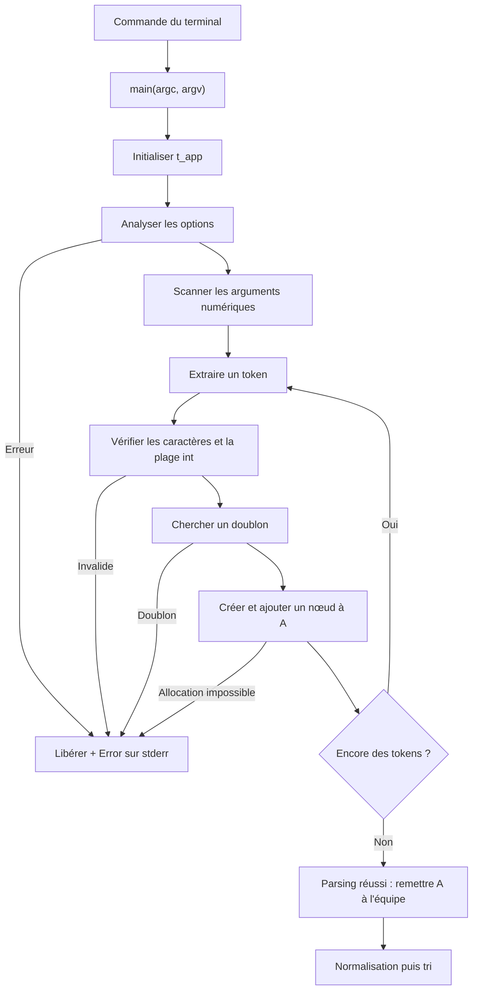

# PUSH_SWAP — Guide de développement du parsing, pas à pas

**Projet 42 — sujet officiel v1.2 · Module `src/parsing/` · Binôme : ______ / ______**  
**Responsable du parsing :** ______  
**Statut :** document pédagogique et plan d'exécution ; ce n'est pas un code complet à copier sans le comprendre.  
**Architecture de référence :** `PUSH_SWAP_PLAN_DE_BATAILLE_A_Z_VERIFIE_SUJET_V1_2.md`  
**Suivi des tâches :** `PUSH_SWAP_CHECKLIST_DEVELOPPEMENT_BINOME_V1_2.md`, identifiants `PAR-001` à `PAR-037`.

> **But :** savoir concevoir, écrire, tester, expliquer et intégrer *soi-même* le parsing de `push_swap`, même si l'on n'est pas encore à l'aise en C. Chaque étape contient un objectif, une explication, quelques extraits de code, des essais concrets et un critère « terminé ».

---

## Mode d'emploi du guide

- Ne commence **pas** par écrire `parse_arguments()` d'un seul bloc. Construis le parseur par petites responsabilités.
- Les snippets sont des **exemples pédagogiques**. Ils se raccordent aux structures du plan, mais leurs noms, signatures et emplacements doivent être validés avec ton binôme **avant** l'intégration.
- Une fonction n'est pas terminée parce qu'elle compile : elle doit réussir ses cas normaux, ses cas limites, la Norminette et les contrôles mémoire.
- **Chaque case est cochée après vérification**, pas simplement après rédaction.
- Dans chaque exercice, explique à voix haute ce que valent les variables ; c'est une très bonne préparation à la correction 42.
- Les mentions **SUJET** ci-dessous sont obligatoires d'après le PDF v1.2 ; les mentions **CHOIX D'ÉQUIPE** sont des règles internes de robustesse, à noter dans `docs/decisions.md`.

### Table des matières

1. [Le rôle précis du parsing](#1-le-rôle-précis-du-parsing)
2. [Ce que le sujet officiel impose](#2-ce-que-le-sujet-officiel-impose)
3. [Architecture et contrat avec le binôme](#3-architecture-et-contrat-avec-le-binôme)
4. [Étape 0 — Préparer son environnement](#4-étape-0--préparer-son-environnement)
5. [Étape 1 — Comprendre `argc` et `argv`](#5-étape-1--comprendre-argc-et-argv)
6. [Étape 2 — Initialiser l'application](#6-étape-2--initialiser-lapplication)
7. [Étape 3 — Reconnaître les options](#7-étape-3--reconnaître-les-options)
8. [Étape 4 — Découper les arguments en nombres](#8-étape-4--découper-les-arguments-en-nombres)
9. [Étape 5 — Convertir un nombre sans risque](#9-étape-5--convertir-un-nombre-sans-risque)
10. [Étape 6 — Refuser les doublons](#10-étape-6--refuser-les-doublons)
11. [Étape 7 — Alimenter la pile A](#11-étape-7--alimenter-la-pile-a)
12. [Étape 8 — Orchestrer le parsing complet](#12-étape-8--orchestrer-le-parsing-complet)
13. [Étape 9 — Traiter les erreurs et la mémoire](#13-étape-9--traiter-les-erreurs-et-la-mémoire)
14. [Étape 10 — Tester les fonctions isolément](#14-étape-10--tester-les-fonctions-isolément)
15. [Étape 11 — Tester les commandes réelles](#15-étape-11--tester-les-commandes-réelles)
16. [Étape 12 — Intégrer avec le reste du programme](#16-étape-12--intégrer-avec-le-reste-du-programme)
17. [Organisation et travail dans Git](#17-organisation-et-travail-dans-git)
18. [Questions typiques de correction](#18-questions-typiques-de-correction)
19. [Checklist finale du module](#19-checklist-finale-du-module)
20. [Annexes : traces et aide-mémoire](#20-annexes--traces-et-aide-mémoire)

---

# 1. Le rôle précis du parsing

Ton travail est de **transformer ce que l'utilisateur écrit dans le terminal en données fiables** pour les trois algorithmes et le dispatcher.

Imagine la commande :

```bash
./push_swap --bench --medium "42 -10" 7
```

À la fin du parsing, on doit avoir :

```text
Options :
  mode demandé : MODE_MEDIUM
  benchmark    : true

Pile A, sommet à gauche :
  [42] -> [-10] -> [7] -> NULL

Pile B : vide

Nombre de valeurs : 3
```

À cette étape :

- on **ne trie pas** les nombres ;
- on **n'affiche pas** `sa`, `pb`, etc. ;
- on **ne calcule pas** la normalisation en rangs (module distinct) ;
- on **ne décide pas** quel algorithme est meilleur ;
- on **garantit** seulement des valeurs valides, distinctes, dans le bon ordre, et les options connues.

## 1.1. Schéma du parcours des données



## 1.2. La règle des trois états

Pour chaque entrée, le parsing doit aboutir à **un seul** de ces états :

| État | Exemple | Attendu |
|---|---|---|
| Entrée absente | `./push_swap` | Fin sans rien afficher |
| Entrée valide | `./push_swap 3 -2 1` | Pile A correcte, options enregistrées |
| Entrée invalide | `./push_swap 3 trois 1` | `Error\n` sur `stderr`, pas d'instructions |

**Point de sécurité :** avant la validation complète, ne lance jamais de tri et n'écris jamais d'opérations sur `stdout`. Une erreur rencontrée au dernier nombre ne doit pas laisser une séquence partielle d'instructions.

---

# 2. Ce que le sujet officiel impose

**Source :** `en.subject (1).pdf`, *Push_swap*, version **1.2**.

## 2.1. Obligations à connaître mot pour mot

| Source | Obligation | Conséquence pour ton code |
|---|---|---|
| p. 15, VI.5 | Programme `push_swap`, liste d'entiers signés | Accepter les nombres négatifs et positifs |
| p. 15, VI.5 | Premier nombre = sommet de A | Ne jamais inverser accidentellement les arguments |
| p. 15, VI.5 | `--simple`, `--medium`, `--complex`, `--adaptive` ; adaptive par défaut | Stocker le mode demandé |
| p. 16, VI.5 | `--bench` optionnel | Stocker un booléen benchmark |
| p. 15, VI.5 | Aucun paramètre → aucun affichage | Traiter `argc == 1` sans erreur |
| p. 16, VI.5 | Arguments erronés → `Error\n` sur `stderr` | Ne pas écrire l'erreur sur `stdout` |
| p. 16, VI.5 | Doublons, valeurs hors `int`, chaînes non numériques sont des erreurs | Valider avant d'allouer/d'utiliser |
| p. 15–16, VI.5 | Chaque mode forcé doit fonctionner avec toute entrée valide | Aucun parseur dépendant de la taille |
| p. 11–12, VI.3.2 | Désordre mesuré avant les mouvements | Préserver l'ordre d'entrée pour ton binôme |
| p. 16, VI.5 | `--bench` : métriques sur `stderr`, mouvements seuls sur `stdout` | Ne pas mélanger les flux |
| p. 4, chapitre II | Norminette, zéro fuite, Makefile conforme | Contrôles réguliers |

**Fonctions externes autorisées dans le binaire :** `read`, `write`, `malloc`, `free`, `exit`, ainsi que votre `ft_printf` ou équivalent personnel ; Libft est autorisée. Évite `atoi`, `strtol`, `printf` de la libc dans le code à livrer. Les scripts de test indépendants peuvent utiliser leurs propres outils, car ils ne sont pas compilés dans `push_swap`.

## 2.2. Ce que le sujet ne détaille PAS

Le PDF ne précise pas intégralement :

- si `"3 2 1"` doit être traité comme trois nombres (support choisi dans notre plan) ;
- si `--bench` peut apparaître après les nombres (nous proposons de l'autoriser) ;
- si un flag identique répété est admis ;
- si les arguments contenant uniquement des espaces doivent être rejetés ;
- la forme exacte du code de retour en cas d'erreur.

### Politique d'équipe proposée — à valider ensemble

- **Accepter** `./push_swap 3 2 1` et `./push_swap "3 2 1"` et les mélanges `"3 2" 1`.
- **Accepter** espaces et tabulations entre nombres dans un même `argv[i]` ; tolérer plusieurs séparateurs consécutifs **entre** les nombres.
- **Accepter** des flags isolés `--simple`, etc., avant **ou** après les arguments numériques.
- **Accepter** exactement **un** sélecteur de stratégie ; `--bench` est indépendant et facultatif.
- **Rejeter** un sélecteur répété ou deux sélecteurs différents, un `--bench` répété, tout flag inconnu.
- **Rejeter** chaque argument vide `""` ou uniquement blanc (`"   "`), s'il est présent dans `argv`.
- **Accepter** `+3`, `-3`, `003`, `+0`, `-0`, en les comparant par valeur numérique.
- **Sans nombres mais avec seulement des flags :** comportement à trancher avec ton binôme ; proposition : ne pas considérer une entrée vide comme une erreur de syntaxe, ne pas émettre de mouvement ; définir séparément si `--bench` imprime un rapport à zéro.
- **En cas d'erreur :** renvoyer un code non nul en plus du `Error\n` obligatoire.

Cette politique est volontairement *plus robuste* que le minimum explicitement exemplifié dans le sujet. **Ne la présente pas comme une citation du PDF.**

---

# 3. Architecture et contrat avec le binôme

## 3.1. Pourquoi commencer par se mettre d'accord

Le parsing manipule des structures définies par l'autre personne. Si tu écris `app->a` comme une simple liste et que ton binôme crée `app->a.head`, les deux parties ne s'assembleront pas.

**Avant de coder :** convenez d'un header commun (`include/push_swap.h`) avec les structures finales, même si les fonctions d'opérations n'existent pas encore.

### Schéma recommandé, cohérent avec notre plan

```c
typedef struct s_node
{
    int                 value;
    int                 rank;
    struct s_node       *next;
    struct s_node       *prev;
}   t_node;

typedef struct s_stack
{
    t_node  *head;
    t_node  *tail;
    int     size;
}   t_stack;

typedef enum e_mode
{
    MODE_ADAPTIVE,
    MODE_SIMPLE,
    MODE_MEDIUM,
    MODE_COMPLEX
}   t_mode;

typedef struct s_options
{
    t_mode  mode;
    int     bench;
}   t_options;
```

Le `t_app` du document principal rassemble `t_stack a`, `t_stack b`, `t_options options`, ainsi que statistiques et taille initiale. **Ces définitions sont un contrat de conception à reprendre ensemble**, pas un header définitif validé par la Norminette. L'indentation des exemples est volontairement pédagogique ; l'indentation finale sera celle de 42.

## 3.2. Ce que tu développes et ce que tu demandes à ton binôme

| Partie | Responsable suggéré | Interface nécessaire |
|---|---|---|
| Reconnaissance des flags | Toi | `parse_flag_kind`, `parse_options` |
| Découpage en tokens | Toi | `parse_next_token`, `parse_scan_arg` |
| Conversion sécurisée | Toi | `parse_int32` |
| Recherche de doublons | Toi | `parse_is_duplicate` |
| Orchestration | Toi | `parse_arguments` |
| Structures de pile | Binôme | `t_node`, `t_stack`, `t_app` |
| Ajout à la fin de A | Binôme, puis intégration commune | `stack_append_value(t_stack *, int)` |
| Initialisation / nettoyage global | À décider ensemble | `app_init`, `app_cleanup` |
| Rang (`rank`) | Binôme ou module normalisation | `rank_normalize` après parsing |
| Tri / opérations / benchmark d'exécution | Binôme ou modules concernés | Aucun appel depuis le parsing |

> **Interface contractuelle proposée :** `stack_append_value(&app->a, value)` retourne `1` si l'ajout réussit, `0` si `malloc` échoue. En cas de succès, la pile devient propriétaire du nœud. En cas d'échec, aucun nouveau nœud ne doit être laissé partiellement lié.

## 3.3. Les fichiers que tu peux viser

```text
include/push_swap.h                 # définitions communes, accord avec ton binôme
src/parsing/parse_options.c         # connaître les flags, mémoriser le mode
src/parsing/parse_tokens.c          # espaces et extraction des tokens
src/parsing/parse_int.c             # signe, chiffres, bornes int
src/parsing/parse_unique.c          # recherche de doublons
src/parsing/parse_arguments.c       # orchestration (à ajouter si besoin)
tests/test_parse_invalid.sh         # script externe de test
```

**Pourquoi `parse_arguments.c` en plus ?** Le plan proposait quatre fichiers pour le parsing ; si la fonction d'orchestration ne tient pas proprement avec les autres sous la Norminette, mieux vaut un cinquième fichier clair qu'une fonction artificiellement tassée. Il ne faut pas créer un fichier par petit helper sans nécessité.

## 3.4. Contrats de fonctions à verrouiller

```c
int     parse_arguments(t_app *app, int argc, char **argv);
int     parse_options(t_app *app, int argc, char **argv);
int     parse_scan_arg(t_app *app, const char *arg);
int     parse_int32(const char *start, size_t len, int *out);
int     parse_is_duplicate(const t_stack *stack, int value);
int     stack_append_value(t_stack *stack, int value);
void    app_init(t_app *app);
void    app_cleanup(t_app *app);
```

**Conventions proposées :**

- `parse_arguments`, `parse_options`, `parse_scan_arg`, `parse_int32` → `1` = réussite, `0` = erreur ;
- `parse_is_duplicate` → `1` = doublon trouvé, `0` = valeur absente ;
- `stack_append_value` → `1` = succès, `0` = échec d'allocation ;
- **aucun helper ne doit appeler `exit()` ou afficher `Error` lui-même**, sauf si vous avez décidé explicitement une autre politique d'erreur ;
- **un seul endroit affiche `Error\n`** après nettoyage, de préférence `main()`.

Avec ce contrat, tout le monde sait ce que signifie chaque retour.

### Checklist de l'accord préalable

- [ ] **PAR-PRÉP-01** — Les noms `t_app`, `t_stack`, `t_node` sont identiques chez les deux développeurs.
- [ ] **PAR-PRÉP-02** — `head` représente **toujours le sommet** de la pile.
- [ ] **PAR-PRÉP-03** — `stack_append_value` ajoute à la **queue**, jamais au sommet.
- [ ] **PAR-PRÉP-04** — Les conventions de retour `0/1` sont écrites dans le header ou dans `docs/decisions.md`.
- [ ] **PAR-PRÉP-05** — Qui écrit `app_init()` et `app_cleanup()` est décidé.
- [ ] **PAR-PRÉP-06** — La gestion des arguments `"3 2 1"` et de l'ordre des flags est décidée.

---

# 4. Étape 0 — Préparer son environnement

**Objectif :** pouvoir compiler et tester une petite fonction avant de lui ajouter d'autres responsabilités.

## 4.1. Préparation minimale

- [ ] Créer une branche Git de travail, par exemple `feature/parsing`.
- [ ] Vérifier la présence de `cc`, `make`, `norminette`.
- [ ] Créer le dossier `src/parsing/`.
- [ ] Vérifier les includes communs disponibles : `<stddef.h>`, `<limits.h>`, éventuellement `<stdlib.h>` pour `malloc/free`.
- [ ] Compiler le squelette `main.c` de l'équipe avec `-Wall -Wextra -Werror`.
- [ ] Demander au binôme un programme minimal qui initialise et libère `t_app` ; **le parser ne doit pas être bloqué par les tris**.

Commandes utiles :

```bash
cc --version
make
norminette src/parsing/
git status
```

En phase d'exercice, tu peux également compiler directement un fichier temporaire de test, **hors du binaire livré** :

```bash
cc -Wall -Wextra -Werror -Iinclude tests/test_parse_int.c \
    src/parsing/parse_int.c -o tests/test_parse_int
```

> `tests/test_parse_int.c` n'existe pas encore : c'est un fichier de test à créer à l'étape 10. Cette commande ne fonctionnera qu'après avoir ajouté le header et la fonction.

---

# 5. Étape 1 — Comprendre `argc` et `argv`

## 5.1. Les deux paramètres de `main`

```c
int main(int argc, char **argv)
{
    /* ... */
}
```

- `argc` signifie **argument count** : nombre d'éléments dans `argv`, **programme compris**.
- `argv` signifie **argument vector** : tableau de chaînes (`char *`).
- `argv[0]` contient le nom/le chemin du programme ; tu ne le tries jamais.
- `argv[1]` est le premier argument utilisateur ; les nombres peuvent démarrer plus loin s'il y a des flags.
- `argv[argc]` vaut `NULL` ; **ne le lis pas comme une chaîne**.

Exemple :

```bash
./push_swap --complex "3 2" -1
```

```text
argc = 4
argv[0] = "./push_swap"
argv[1] = "--complex"
argv[2] = "3 2"
argv[3] = "-1"
argv[4] = NULL
```

**Attention aux guillemets :** le shell a déjà traité les guillemets. Il transmet `"3 2"` comme **une seule chaîne** contenant un espace, et non comme deux chaînes ni comme un texte incluant les guillemets.

## 5.2. Pourquoi le parcours commence à 1

```c
int i;

i = 1;
while (i < argc)
{
    /* traiter argv[i] */
    i++;
}
```

Ce motif doit te devenir familier. Tu l'utiliseras plusieurs fois.

## 5.3. Mini-exercices (sans coder)

**Exercice A** — Que valent `argc` et les éléments d'`argv` pour `./push_swap 3 -2 1` ?  
**Exercice B** — Même question pour `./push_swap "3 -2 1"`.  
**Exercice C** — Pourquoi `argv[0]` ne doit-il pas être converti en nombre ?  
**Exercice D** — Que doit faire le programme si `argc == 1` ?

<details>
<summary>Réponses — à consulter après avoir essayé</summary>

- A : `argc=4`, arguments utilisateurs `"3"`, `"-2"`, `"1"`.
- B : `argc=2`, un seul argument utilisateur `"3 -2 1"`.
- C : il contient le nom du binaire.
- D : terminer sans rien écrire sur `stdout` ni `stderr`.

</details>

### Validation étape 1

- [ ] Je distingue `argc`, `argv`, `argv[0]` et `argv[argc]`.
- [ ] Je sais expliquer les effets des guillemets du shell.
- [ ] Je sais dessiner ce que reçoit le programme avant d'écrire un parseur.

---

# 6. Étape 2 — Initialiser l'application

## 6.1. Pourquoi initialiser les pointeurs ?

Si une erreur survient au troisième nombre, le programme doit libérer les deux nœuds déjà créés. Il faut donc que la pile ait **toujours** un état connu :

```text
Avant le parsing :
  A.head = NULL
  A.tail = NULL
  A.size = 0
  B.head = NULL
  B.tail = NULL
  B.size = 0
  options.mode = MODE_ADAPTIVE
  options.bench = 0
```

La fonction `app_init()` devra initialiser *tous* les champs réellement présents dans `t_app` (y compris statistiques et indicateurs). **Ne te contente pas d'initialiser A si `app_cleanup()` utilise B et les stats.**

### Petit exemple d'initialisation des options

```c
app->options.mode = MODE_ADAPTIVE;
app->options.bench = 0;
```

Ici `=` **affecte** une valeur ; ne pas confondre avec `==`, qui **compare**.

### Validation étape 2

- [ ] `app_init()` place A et B à l'état vide.
- [ ] Le mode par défaut est `MODE_ADAPTIVE`.
- [ ] Le benchmark est désactivé par défaut.
- [ ] `app_cleanup()` peut être appelé même juste après `app_init()`.
- [ ] Un test sous Valgrind ne signale aucune libération invalide sur cet état vide.

---

# 7. Étape 3 — Reconnaître les options

**Objectif :** savoir distinguer un flag d'un nombre négatif sans appeler un algorithme.

## 7.1. Les cinq seules options reconnues

| Texte exact | Effet |
|---|---|
| `--simple` | `MODE_SIMPLE` |
| `--medium` | `MODE_MEDIUM` |
| `--complex` | `MODE_COMPLEX` |
| `--adaptive` | `MODE_ADAPTIVE` |
| `--bench` | Active `bench`, sans sélectionner un tri différent |

`--bench` est un **modificateur de sortie**. Il n'est **pas** un cinquième algorithme.

## 7.2. Comparer deux chaînes complètement

On veut que `--bench` corresponde **exactement** à `--bench`, pas à `--benchmarks`.

Une comparaison du seul préfixe est insuffisante. En Libft, on peut utiliser un `ft_strncmp` avec une longueur incluant le caractère final `\0`, ou créer un petit helper privé `parse_same()`.

Illustration du principe :

```c
static int parse_same(const char *a, const char *b)
{
    size_t i;

    i = 0;
    while (a[i] && b[i] && a[i] == b[i])
        i++;
    return (a[i] == b[i]);
}
```

**Déroulement :** deux chaînes sont égales si chaque caractère correspond et si elles se terminent **au même endroit**. Si l'une est plus longue, le résultat est faux.

> Hypothèse du helper : `a` et `b` sont non-`NULL`. Dans notre usage, `argv[i]` est non-`NULL` tant que `i < argc`, et les constantes de flags existent toujours.

## 7.3. Premier choix de conception : une énumération de flags

La fonction de lecture des flags ne doit pas, à elle seule, trier, allouer ou écrire dans une pile.

```c
typedef enum e_flag
{
    FLAG_NONE,
    FLAG_SIMPLE,
    FLAG_MEDIUM,
    FLAG_COMPLEX,
    FLAG_ADAPTIVE,
    FLAG_BENCH
}   t_flag;
```

**Contrat proposé :** `parse_flag_kind("--simple")` retourne `FLAG_SIMPLE`; `parse_flag_kind("-3")` retourne `FLAG_NONE` ; `parse_flag_kind("--unknown")` retourne `FLAG_NONE` (il sera rejeté ensuite comme argument non numérique).

### Extrait de reconnaissance

```c
if (parse_same(arg, "--bench"))
    return (FLAG_BENCH);
if (parse_same(arg, "--simple"))
    return (FLAG_SIMPLE);
/* idem pour les trois autres options */
return (FLAG_NONE);
```

**Pourquoi ne pas faire `if (arg[0] == '-')` ?** Parce que `-3` est un entier parfaitement valide. Le signe moins n'identifie pas un flag.

## 7.4. Deuxième choix : gérer les conflits

Un mode est sélectionné au maximum une fois ; `--bench` peut l'accompagner.

```text
./push_swap --simple 3 2 1
    → mode simple

./push_swap --bench --simple 3 2 1
    → mode simple + rapport benchmark

./push_swap --simple --complex 3 2 1
    → erreur : deux stratégies

./push_swap --simple --simple 3 2 1
    → erreur : stratégie répétée (CHOIX D'ÉQUIPE)
```

Un booléen `selector_seen` suffit. Il permet également de distinguer `--adaptive` **explicitement demandé** du mode adaptive **par défaut** : les deux ont la même valeur `MODE_ADAPTIVE`, mais le deuxième sélecteur reste un conflit.

### Un bon ordre d'implémentation

1. Écrire `parse_same` (ou utiliser `ft_strncmp` correctement).
2. Écrire `parse_flag_kind` en ne reconnaissant que les cinq textes complets.
3. Écrire une petite fonction qui traduit un `FLAG_*` en mode ou benchmark.
4. Écrire `parse_options` : parcourir chaque `argv[i]`, ignorer les chaînes numériques, enregistrer les flags, détecter les conflits.
5. Préserver les nombres pour une **deuxième passe** ; ne pas les convertir dans `parse_options`.

Pourquoi deux passes ? **C'est plus simple pour débuter** : d'abord on fixe les options, ensuite on construit la pile dans l'ordre original. Cela coûte un parcours supplémentaire en C, mais n'émet aucune instruction `push_swap`.

### Un piège important

N'appelle **pas** une fonction de détection qui *modifie* le mode depuis la deuxième passe pour simplement savoir si l'argument est un flag ; tu risquerais de compter le même flag deux fois. Utilise à cet endroit la fonction **pure** `parse_flag_kind`.

### Validation étape 3

- [ ] **PAR-001** — `parse_options` choisit le mode, sans modifier A ou B.
- [ ] **PAR-002** — `parse_flag_kind` distingue `--simple` et `-3`.
- [ ] `--bench` n'efface pas le mode choisi.
- [ ] Le mode par défaut reste adaptive.
- [ ] Deux modes forcés différents sont rejetés.
- [ ] Un flag inconnu sera rejeté, jamais ignoré silencieusement.
- [ ] Les tests `--bench --simple` et `--simple --bench` donnent les mêmes options.

---

# 8. Étape 4 — Découper les arguments en nombres

**Objectif :** transformer un argument `"  42\t-10   7  "` en trois morceaux de texte `"42"`, `"-10"`, `"7"`, sans encore les convertir.

## 8.1. Les espaces font partie du parsing

Dans le terminal :

```bash
./push_swap "42 -10 7"
```

Le shell envoie une seule chaîne contenant **trois nombres**. Si tu appelles directement `ft_atoi(argv[1])`, tu récupéreras au mieux `42` et tu perdras le reste. Et `ft_atoi` seul ne vérifierait ni les caractères résiduels ni les débordements.

La solution consiste à **parcourir la chaîne caractère par caractère**, rechercher les débuts et fins de tokens, puis passer chaque token au validateur numérique.

## 8.2. Qu'est-ce qu'un token ?

Un token est une **séquence continue de caractères non séparateurs**.

```text
argv[i] = "  42   -10  7 "
           ^^  ^^^  ^
           |   |    |
         token token token
```

Pour notre politique d'équipe, on considère les espaces ASCII :

- `' '` : espace ordinaire ;
- `\t` : tabulation ;
- `\n`, `\r`, `\v`, `\f` : séparateurs de même famille (ASCII 9 à 13).

Le sujet n'impose pas explicitement ce jeu précis de séparateurs. C'est notre tolérance choisie, qu'il faut appliquer de façon cohérente.

### Petit helper : reconnaître un séparateur

```c
static int parse_is_space(char c)
{
    return (c == ' ' || (c >= 9 && c <= 13));
}
```

## 8.3. Deux façons de découper

| Méthode | Principe | Avantages | Inconvénients |
|---|---|---|---|
| `ft_split` | Allouer un tableau de nouvelles chaînes | Facile à visualiser | Plus d'allocations/libérations ; séparateur unique |
| **Scanner sans allocation** | Conserver un pointeur de début + une longueur | **Recommandé** : pas de chaînes temporaires, moins de fuites | Demande de comprendre les indices |

Je te conseille le **scanner**, même si tu es encore débutant : il est petit, fiable et c'est un excellent exercice de pointeurs.

## 8.4. Le rôle de `start`, `len` et `cursor`

Imagine :

```text
Chaîne :  "  42   -10  7"
Index  :   0123456789012

Premier token : start = &s[2], len = 2       → "42"
Deuxième token : start = &s[7], len = 3      → "-10"
Troisième token : start = &s[12], len = 1    → "7"
```

On ne crée **aucun nouveau `char *` avec `malloc`**. On pointe vers le milieu de la chaîne existante, qu'on lit sur `len` caractères.

**Attention :** `start` ne pointe pas nécessairement vers une chaîne terminée par `\0` après le token. Par conséquent, appeler `ft_atoi(start)` ou `ft_strlen(start)` pour ne traiter que ce token est une erreur. Il faut utiliser **`start + len`** comme frontière logique.

## 8.5. Extrait pédagogique : extraire le token suivant

Voici une petite fonction complète et autonome (après avoir écrit `parse_is_space`) :

```c
int parse_next_token(const char *s, size_t *cursor,
        const char **start, size_t *len)
{
    size_t i;
    size_t first;

    i = *cursor;
    while (s[i] && parse_is_space(s[i]))
        i++;
    if (!s[i])
    {
        *cursor = i;
        return (0);
    }
    first = i;
    while (s[i] && !parse_is_space(s[i]))
        i++;
    *start = s + first;
    *len = i - first;
    *cursor = i;
    return (1);
}
```

**Contrat :**

- `1` → un token trouvé ; `*start` et `*len` sont mis à jour ;
- `0` → fin de l'argument ;
- `cursor` contient l'endroit où reprendre ;
- aucun `malloc`, aucun `free`, aucune modification de la chaîne.

**Précondition :** `s`, `cursor`, `start` et `len` sont des pointeurs valides ; `*cursor` ne doit pas dépasser la longueur de la chaîne. Le code appelant garantit cela.

### Trace à la main

Pour `"  42 -10"`, initialise `cursor=0`.

| Appel | `cursor` avant | Token | `len` | `cursor` après |
|---|---:|---|---:|---:|
| 1 | 0 | `42` | 2 | 4 |
| 2 | 4 | `-10` | 3 | 8 |
| 3 | 8 | Aucun | — | 8 |

**Exercice :** refais cette trace sur `"\t+0   0007"`.

## 8.6. Le cas des arguments vides

`parse_next_token("   ", ...)` retourne logiquement `0` : aucun token n'a été trouvé.

Mais selon notre **politique d'équipe**, un argument explicitement fourni mais vide ou blanc est **invalide**. La fonction qui parcourt tout un argument doit donc garder un `seen_token` :

```c
size_t cursor;
int seen_token;

cursor = 0;
seen_token = 0;
while (parse_next_token(arg, &cursor, &start, &len))
{
    seen_token = 1;
    /* convertir puis ajouter ce token */
}
if (!seen_token)
    return (0);  /* argument vide ou blanc : erreur choisie */
```

## 8.7. L'option `parse_count_values`

Notre checklist comporte `PAR-003 : parse_count_values`. **Ce helper est facultatif avec une liste chaînée**, car tu peux créer les nœuds à mesure que tu les valides : il n'est pas nécessaire de connaître leur nombre à l'avance.

- Si votre architecture doit allouer un **tableau de taille exacte**, `parse_count_values` devient utile.
- Si vous ajoutez directement des nœuds à A, vous pouvez noter la tâche `PAR-003` comme « non applicable — justification : allocation incrémentale » dans le suivi, plutôt que créer une fonction inutile.

### Validation étape 4

- [ ] **PAR-004** — `parse_next_token` retourne des plages `start/len` exactes.
- [ ] **PAR-005** — `parse_is_space` a une politique explicite.
- [ ] **PAR-022** — Un argument vide/blanc est détecté selon la règle choisie.
- [ ] **PAR-023** — `"3 2 1"` et `"3 2" "1"` donnent trois tokens dans le bon ordre.
- [ ] **PAR-024** — Plusieurs séparateurs consécutifs ne créent pas de faux nombres.
- [ ] Le scanner n'alloue aucune mémoire et ne modifie pas `argv`.

---

# 9. Étape 5 — Convertir un nombre sans risque

C'est **le cœur technique du parsing**. Pas besoin de mathématiques compliquées : il faut seulement vérifier chaque caractère et empêcher les débordements.

## 9.1. Ce que doit accepter `parse_int32`

| Token | Accepté ? | Valeur |
|---|---|---:|
| `42` | Oui | 42 |
| `-42` | Oui | -42 |
| `+42` | Oui | 42 |
| `00042` | Oui | 42 |
| `+0` | Oui | 0 |
| `-0` | Oui | 0 |
| `2147483647` | Oui | 2147483647 |
| `-2147483648` | Oui | -2147483648 |
| `2147483648` | Non | Hors `int` 32 bits |
| `-2147483649` | Non | Hors `int` 32 bits |
| `+` / `-` | Non | Signe sans chiffre |
| `1a` / `3.14` / `1-2` | Non | Caractère invalide |
| `99999999999999999999999999` | Non | Nombre trop grand |

## 9.2. Pourquoi `ft_atoi` ne suffit pas

`ft_atoi` convertit des chiffres, mais ne signale pas proprement **tous** les cas d'entrée invalide :

- `"12abc"` peut produire `12` alors que la chaîne doit être rejetée ;
- une valeur hors `int` n'est pas validée pour ton usage ;
- `"+"` n'est pas un nombre ;
- ici, le token n'est pas nécessairement terminé par `\0` juste après ses chiffres.

**Donc :** écrire une fonction `parse_int32(start, len, &value)` qui retourne succès/échec.

## 9.3. Comprendre le calcul chiffre par chiffre

Pour le texte `"257"` :

| Caractère | Valeur avant | Calcul | Valeur après |
|---|---:|---|---:|
| `'2'` | 0 | `0 * 10 + 2` | 2 |
| `'5'` | 2 | `2 * 10 + 5` | 25 |
| `'7'` | 25 | `25 * 10 + 7` | 257 |

En C, passer du caractère `'7'` à l'entier `7` :

```c
int digit;

digit = s[i] - '0';
```

C'est correct **uniquement après** avoir vérifié `s[i] >= '0' && s[i] <= '9'`.

## 9.4. Les limites des entiers signés

Sous les hypothèses usuelles du sujet (un `int` 32 bits) :

```text
INT_MAX =  2147483647
INT_MIN = -2147483648
```

La partie négative peut avoir une magnitude de **2147483648**, un de plus que `INT_MAX`.

**Le piège :** on ne peut pas représenter `+2147483648` dans un `int`. Ne fais donc **jamais** `int value = -INT_MIN;` : c'est un débordement signé.

Solution pédagogique : accumuler la magnitude dans un `long long` **mais ne jamais le laisser grandir sans contrôle**, puis appliquer le signe et convertir en `int` seulement après validation. Un `long long` est un type du langage C, pas une fonction externe interdite.

## 9.5. La formule anti-débordement

On voudrait faire :

```c
number = number * 10 + digit;
```

**Avant** de le faire, il faut vérifier que le résultat n'excédera pas `limit` :

```c
if (number > (limit - digit) / 10)
    return (0);
```

Où :

- `number` est la magnitude déjà convertie (`long long`, toujours positive ou nulle) ;
- `digit` est entre `0` et `9` ;
- `limit` vaut `2147483647` pour un nombre positif, `2147483648` pour un nombre négatif.

La vérification a lieu **avant** la multiplication. Même une chaîne de mille chiffres sera rejetée dès qu'un nouveau chiffre dépasse la limite.

### Exemple : `2147483648`

Avant le dernier chiffre : `number = 214748364`, `digit = 8`, `limit = 2147483647`.

Le test détecte que `214748364 * 10 + 8 = 2147483648` serait trop grand. La fonction retourne une erreur, sans effectuer le calcul dangereux dans un `int`.

### Exemple : `-2147483648`

Cette fois `limit = 2147483648`. Le dernier chiffre `8` est permis ; on applique ensuite le signe négatif, ce qui donne un entier représentable.

## 9.6. Découper la fonction en trois responsabilités

Cela aide à respecter la limite de **25 lignes par fonction** de 42.

### A. Lire le signe

```c
static int parse_sign(const char *s, size_t len,
        size_t *i, int *sign)
{
    *sign = 1;
    if (*i < len && (s[*i] == '+' || s[*i] == '-'))
    {
        if (s[*i] == '-')
            *sign = -1;
        (*i)++;
    }
    return (*i < len);
}
```

**Pourquoi retourner `(*i < len)` ?** Pour rejeter `"+"` et `"-"` : après le signe, il doit rester au moins un caractère à examiner.

### B. Lire les chiffres avec contrôle de limite

```c
static int parse_digits(const char *s, size_t len,
        size_t i, long long *number, long long limit)
{
    int digit;

    *number = 0;
    while (i < len)
    {
        if (s[i] < '0' || s[i] > '9')
            return (0);
        digit = s[i] - '0';
        if (*number > (limit - digit) / 10)
            return (0);
        *number = *number * 10 + digit;
        i++;
    }
    return (1);
}
```

**Pourquoi `size_t i` et `size_t len` ?** Ce sont des grandeurs de taille et d'index : `size_t` est prévu pour représenter des tailles en C. Il évite de confondre des positions et les valeurs numériques que l'on trie.

### C. Assembler la conversion

```c
int parse_int32(const char *s, size_t len, int *out)
{
    size_t      i;
    int         sign;
    long long   number;
    long long   limit;

    i = 0;
    if (!s || !out || !parse_sign(s, len, &i, &sign))
        return (0);
    limit = INT_MAX;
    if (sign < 0)
        limit = -(long long)INT_MIN;
    if (!parse_digits(s, len, i, &number, limit))
        return (0);
    if (sign < 0)
        number = -number;
    *out = (int)number;
    return (1);
}
```

**Pré-requis :** inclure `<limits.h>` (`INT_MIN`, `INT_MAX`) et `<stddef.h>` (`size_t`). Les trois fonctions peuvent vivre dans `parse_int.c` avec `parse_sign` et `parse_digits` déclarées `static`, car elles ne servent qu'à ce fichier.

> Ces extraits forment volontairement un **mini-module lisible**. Lis-les et reprogramme-les toi-même en comprenant chaque condition. Adapte leur indentation à la Norminette sur ta machine. Tu peux d'abord tester la conversion **sans aucune pile**.

### Trace détaillée : `-105`

1. `i = 0`, `sign = 1`.
2. Le caractère `'-'` est reconnu → `sign = -1`, `i = 1`.
3. `limit = 2147483648`.
4. `'1'` → `number = 1`.
5. `'0'` → `number = 10`.
6. `'5'` → `number = 105`.
7. Signe appliqué → `number = -105`.
8. Conversion sûre vers `int` → `*out = -105` ; retour `1`.

### Trace d'erreur : `12x`

1. `'1'` → `number = 1`.
2. `'2'` → `number = 12`.
3. `'x'` → ce n'est pas un chiffre → retour `0`.
4. La sortie `*out` n'est pas utilisée ; aucun nœud n'est créé pour ce token.

## 9.7. Les pièges à mémoriser

- Un caractère `'5'` n'est pas l'entier `5` : il faut faire `- '0'`.
- `INT_MIN` est valide ; **`-INT_MIN` dans un `int` ne l'est pas**.
- `+` et `-` seuls ne sont pas des nombres.
- Ne jamais s'arrêter silencieusement sur `a` dans `12a`.
- Les zéros en tête sont acceptés dans notre politique : `00012 = 12`.
- `-0` et `+0` valent tous deux `0` et seront gérés par l'étape doublons.
- La valeur de `*out` n'est fiable **que si la fonction retourne 1**.

### Validation étape 5

- [ ] **PAR-006** — J'ai écrit une fonction de conversion basée sur `(start, len, out)`.
- [ ] `2147483647` et `-2147483648` réussissent.
- [ ] `2147483648`, `-2147483649`, et un entier de 100 chiffres échouent sans overflow.
- [ ] `+`, `-`, `12x`, `3.14`, `0x10`, `1_000` échouent.
- [ ] `+0`, `-0`, `0001` sont convertis en valeurs correctes.
- [ ] Je peux expliquer oralement la formule `(limit - digit) / 10`.
- [ ] Les fonctions sont conformes aux limites de la Norminette.

---

# 10. Étape 6 — Refuser les doublons

**Objectif :** refuser deux nombres qui ont la même valeur, même si leur écriture est différente.

## 10.1. Le piège des chaînes

```bash
./push_swap 3 03
./push_swap 0 -0
./push_swap +5 5
```

Dans les trois cas, le parsing doit détecter **deux fois le même entier**.

Une comparaison de textes ne suffit pas : `"03"` et `"3"` sont différents en caractères, mais identiques en valeur (`3`).

## 10.2. La recherche la plus simple

Puisque A contient **tous les nombres déjà acceptés**, il suffit de la parcourir du sommet à la queue pour chercher une valeur égale.

```c
int parse_is_duplicate(const t_stack *stack, int value)
{
    const t_node *current;

    current = stack->head;
    while (current)
    {
        if (current->value == value)
            return (1);
        current = current->next;
    }
    return (0);
}
```

**Exemple :** A contient `42 -> -10 -> 7`, on essaie d'ajouter `-10` : la fonction retourne `1`, sans modifier A.

## 10.3. Pourquoi une recherche linéaire suffit ici

Sur 500 valeurs, la vérification peut entraîner des comparaisons en C. C'est acceptable : le critère `O(n²) / O(n√n) / O(n log n)` du sujet concerne les **instructions `push_swap` produites par les stratégies**, pas les comparaisons internes du parsing.

La complexité temporelle totale du parsing peut donc être quadratique en CPU sans transformer Radix en algorithme quadratique **en nombre de mouvements**. Il faut simplement bien distinguer ces deux notions à l'oral.

## 10.4. Ordre correct des vérifications

```text
Extraire token → convertir en int → chercher doublon → créer nœud
```

**Pas l'inverse** : si le nombre est invalide, inutile de créer un nœud ; s'il est déjà présent, inutile d'allouer.

### Validation étape 6

- [ ] **PAR-007** — Recherche de doublon écrite sans modifier les piles.
- [ ] **PAR-019** — `0 -0`, `1 01`, `+0 0`, `-0001 -1` sont rejetés.
- [ ] **PAR-020/021** — Les textes invalides sont rejetés pendant la conversion, avant la recherche de doublons.
- [ ] Une valeur identique peut être détectée même si elle apparaît très loin après la première.

---

# 11. Étape 7 — Alimenter la pile A

Cette étape est en partie **partagée avec ton binôme** : tu valides les nombres, l'autre développeur fournit les fonctions d'ajout de nœuds.

## 11.1. La différence entre `head` et `tail`

Dans notre architecture :

```text
             sommet                         fin
               ↓                             ↓
A.head --> [42] <--> [-10] <--> [7] <-- A.tail
```

Si tu lis les arguments dans l'ordre `42`, `-10`, `7`, tu dois ajouter chaque nouveau nœud **à la fin**.

### Ce qu'il ne faut PAS faire

Si tu fais trois ajouts au **sommet** :

```text
ajouter 42 au sommet → [42]
ajouter -10 au sommet → [-10, 42]
ajouter 7 au sommet  → [7, -10, 42]    ← mauvais ordre
```

### Ce qu'il faut faire

```text
ajouter 42 à la queue → [42]
ajouter -10 à la queue → [42, -10]
ajouter 7 à la queue  → [42, -10, 7]    ← ordre correct
```

## 11.2. Le contrat du helper de pile

**Fonction fournie par l'autre développeur :**

```c
int stack_append_value(t_stack *stack, int value);
```

Elle doit :

1. allouer **un** nœud (`malloc(sizeof(t_node))`) ;
2. remplir `value` et, au départ, `rank = -1` ;
3. initialiser `next = NULL` ;
4. relier `prev` à l'ancienne queue ;
5. si A est vide, positionner **à la fois** `head` et `tail` sur ce nœud ;
6. sinon, positionner `old_tail->next` sur ce nœud et remplacer `tail` ;
7. incrémenter `size` **une seule fois après succès** ;
8. retourner `1` après succès, `0` après échec d'allocation ;
9. ne jamais afficher d'instruction ni appeler un algorithme.

Il faut également un `app_cleanup` qui libère tous les nœuds, même après un échec au milieu du parcours.

## 11.3. L'assemblage conversion + unicité + ajout

Tu peux regrouper ces trois actions dans une petite fonction de responsabilité unique :

```c
int parse_token_to_stack(t_app *app,
        const char *start, size_t len)
{
    int value;

    if (!parse_int32(start, len, &value))
        return (0);
    if (parse_is_duplicate(&app->a, value))
        return (0);
    if (!stack_append_value(&app->a, value))
        return (0);
    return (1);
}
```

**Pourquoi est-ce utile ?** La fonction qui scanne les arguments restera très courte et la Norminette sera plus simple à respecter.

## 11.4. Invariants à vérifier après chaque ajout

Un invariant est une propriété qui doit être **toujours vraie** à une étape donnée.

- Si `size == 0`, alors `head == NULL` et `tail == NULL`.
- Si `size == 1`, alors `head == tail` ; `head->prev == NULL` ; `head->next == NULL`.
- Si `size >= 2`, alors `head->prev == NULL` et `tail->next == NULL`.
- En parcourant `next` depuis `head`, on visite exactement `size` nœuds.
- En parcourant `prev` depuis `tail`, on retrouve les mêmes nœuds en sens inverse.
- Aucun doublon numérique n'est stocké dans A.
- Le premier nombre utilisateur reste en tête de A.

### Validation étape 7

- [ ] **PAR-008** — Tous les nombres validés sont ajoutés à **la queue** de A.
- [ ] Après `42 -10 7`, A est exactement `42 -> -10 -> 7`.
- [ ] Les tailles 0, 1 et 2 sont correctes.
- [ ] Aucune allocation d'un token temporaire n'est nécessaire.
- [ ] Les échecs de `malloc` laissent A dans un état libérable.

---

# 12. Étape 8 — Orchestrer le parsing complet

**Objectif :** relier les fonctions déjà testées sans écrire une fonction de 80 lignes.

## 12.1. La stratégie en deux passes

**Première passe :** parcourir `argv` pour reconnaître les flags et enregistrer les options.  
**Deuxième passe :** parcourir `argv` dans son ordre original, ignorer les flags reconnus, scanner puis ajouter chaque nombre à A.

```text
argc, argv
   │
   ├── passe 1 : flags seulement
   │      mode / bench / conflits
   │
   └── passe 2 : valeurs seulement
          token → int → doublon → append A
```

**Avantage :** un flag placé après un nombre est pris en compte sans te forcer à mélanger conversion et choix de stratégie dans une seule boucle.

## 12.2. Parcourir un seul argument numérique

Voici un squelette directement raccordable aux helpers précédents :

```c
int parse_scan_arg(t_app *app, const char *arg)
{
    size_t      cursor;
    const char  *start;
    size_t      len;
    int         seen_token;

    if (!arg || !*arg)
        return (0);
    cursor = 0;
    seen_token = 0;
    while (parse_next_token(arg, &cursor, &start, &len))
    {
        seen_token = 1;
        if (!parse_token_to_stack(app, start, len))
            return (0);
    }
    return (seen_token);
}
```

**À expliquer :**

- `cursor` représente l'endroit où reprendre la lecture ;
- `start` pointe vers le début du token ;
- `len` est son nombre de caractères ;
- `seen_token` distingue « plus de tokens » de « argument explicitement vide » ;
- si un token est invalide, l'orchestrateur s'arrête, puis **l'appelant** s'occupe du nettoyage et de l'erreur.

## 12.3. La fonction centrale `parse_arguments`

Exemple de squelette :

```c
int parse_arguments(t_app *app, int argc, char **argv)
{
    int i;

    if (!parse_options(app, argc, argv))
        return (0);
    i = 1;
    while (i < argc)
    {
        if (parse_flag_kind(argv[i]) == FLAG_NONE
            && !parse_scan_arg(app, argv[i]))
            return (0);
        i++;
    }
    return (1);
}
```

**Attention :** ce code suppose que `parse_options` a déjà rejeté les sélecteurs répétés, les conflits et les flags inconnus (ou que les inconnus échoueront ensuite dans `parse_scan_arg`). Il suppose également que `app_init()` a été appelé avant.

Ce squelette **n'imprime aucune erreur**. Il ne fait que renvoyer `0` ou `1`.

## 12.4. Lecture du déroulement complet

Entrée :

```bash
./push_swap --bench "42 -10" --medium 7
```

| Étape | Action | Résultat |
|---|---|---|
| `app_init` | initialise l'état | adaptive, bench=0, A vide |
| Options : `--bench` | reconnu | bench=1 |
| Options : `"42 -10"` | pas un flag | ignoré durant passe 1 |
| Options : `--medium` | reconnu | mode=medium |
| Options : `7` | pas un flag | ignoré durant passe 1 |
| Tokens : `"42 -10"` | extrait `42` | int 42, ajouté à A |
| Tokens : `"42 -10"` | extrait `-10` | int -10, ajouté à A |
| Tokens : `7` | extrait `7` | int 7, ajouté à A |
| Sortie du parsing | succès | A = [42, -10, 7] |

**Le calcul de désordre (chez ton binôme) commence ensuite**, sur cette entrée déjà validée et avant toute opération de tri.

### Validation étape 8

- [ ] **PAR-009** — `parse_arguments` orchestre les deux passes.
- [ ] Un flag situé entre deux arguments numériques ne change pas l'ordre de A.
- [ ] Une option inconnue ne peut jamais être ignorée silencieusement.
- [ ] En sortie de parsing réussi, A a la bonne taille, B est vide, les valeurs sont uniques.
- [ ] Aucun `sa`, `pb` ou autre mouvement n'est écrit durant le parsing.

---

# 13. Étape 9 — Traiter les erreurs et la mémoire

## 13.1. Où afficher `Error` ?

Le sujet impose **exactement** :

```text
Error\n
```

sur **`stderr`**, c'est-à-dire le descripteur `2`.

En C :

```c
write(2, "Error\n", 6);
```

Pourquoi `6` ? Les lettres `E r r o r` comptent cinq caractères et `\n` est le sixième caractère. `write` ne doit pas afficher le `\0` final.

**Ne pas écrire** `write(1, "Error\n", 6)` : le descripteur `1` est `stdout`, réservé aux instructions de tri.

## 13.2. Une seule responsabilité pour l'affichage de l'erreur

Je te conseille :

```text
parse_int32       → 0 si invalide
parse_scan_arg    → 0 si un token échoue
parse_arguments   → 0 si une étape échoue
main              → nettoie, écrit Error\n une fois, termine
```

Extrait d'intégration (pas un `main` complet) :

```c
app_init(&app);
if (argc == 1)
    return (0);
if (!parse_arguments(&app, argc, argv))
{
    app_cleanup(&app);
    write(2, "Error\n", 6);
    return (1);
}
/* La normalisation et le tri démarrent seulement ici. */
```

**Important :** avec `argc == 1`, l'extrait retourne sans nettoyer ; c'est sans risque uniquement si `app_init` n'a pas alloué de mémoire. Si votre initialisation alloue, appelez `app_cleanup` avant de retourner. Le `main` final doit aussi nettoyer après un tri réussi.

## 13.3. Exemple d'erreur tardive

```bash
./push_swap 8 4 2 1 3 9 5 6 7 4
```

Le dernier `4` est un doublon. Au moment de l'erreur, les neuf premiers nœuds ont été créés.

Le programme doit :

1. détecter que `4` existe déjà ;
2. arrêter le parsing ;
3. libérer **tous les nœuds déjà créés** ;
4. écrire `Error\n` une seule fois sur `stderr` ;
5. ne rien écrire sur `stdout` ;
6. terminer sans segfault ni fuite mémoire.

## 13.4. Le cas d'un `malloc` qui échoue

L'échec peut se produire :

- sur le premier nœud ;
- au milieu de la liste ;
- sur le dernier nœud ;
- dans une allocation annexe décidée par votre équipe.

Le contrat de `stack_append_value` doit assurer que si l'allocation échoue, les nœuds précédents restent accessibles et libérables. Ton parser retournera `0` ; `main` fera le nettoyage.

## 13.5. Qui libère quoi ?

| Objet | Qui le crée ? | Qui le libère ? |
|---|---|---|
| Chaînes `argv` | Shell / environnement d'exécution | **Jamais** ton code |
| Pointeurs `start` vers tokens | Ton scanner, sans allocation | **Personne** (pas de `free`) |
| Nœuds de A | `stack_append_value` via `malloc` | `app_cleanup` |
| Pile B | Aucune allocation initiale de nœuds | `app_cleanup` après les mouvements |
| Tableau de normalisation | Module normalisation, s'il existe | Module normalisation après usage |

`free(argv[i])` serait une erreur : tu ne possèdes pas cette mémoire.

### Validation étape 9

- [ ] **PAR-010** — Une seule fonction/endroit centralise `Error\n`.
- [ ] **PAR-011** — L'initialisation permet un nettoyage sûr après tout échec.
- [ ] **PAR-033** — Erreur après plusieurs valeurs : aucune instruction de tri affichée.
- [ ] **PAR-034** — Échec d'allocation : aucune fuite, aucun double `free`.
- [ ] **PAR-036** — On contrôle séparément stdout et stderr.
- [ ] Aucun `free` n'est appelé sur une sous-chaîne pointée par `start`.

---

# 14. Étape 10 — Tester les fonctions isolément

**Règle :** commence par tester les plus petites fonctions avant d'essayer d'intégrer tout le programme.

## 14.1. Tests de `parse_int32`

Crée un exécutable de test **séparé du projet livré**, par exemple `tests/test_parse_int.c`. Il doit appeler `parse_int32` sur des chaînes connues, comparer le retour et la valeur attendue, puis afficher les échecs.

Le pseudocode suivant montre l'idée :

```text
pour chaque cas (texte, longueur, validité attendue, valeur attendue) :
    valeur = sentinelle
    résultat = parse_int32(texte, longueur, &valeur)
    vérifier résultat == validité attendue
    si résultat est vrai, vérifier valeur == valeur attendue
```

Cas minimum :

| Texte | Longueur | Retour attendu | Valeur si succès |
|---|---:|---:|---:|
| `0` | 1 | 1 | 0 |
| `-0` | 2 | 1 | 0 |
| `+17` | 3 | 1 | 17 |
| `00042` | 5 | 1 | 42 |
| `-2147483648` | 11 | 1 | -2147483648 |
| `2147483647` | 10 | 1 | 2147483647 |
| `2147483648` | 10 | 0 | sans objet |
| `-2147483649` | 11 | 0 | sans objet |
| `-` | 1 | 0 | sans objet |
| `1a` | 2 | 0 | sans objet |
| `3.5` | 3 | 0 | sans objet |
| `9999999999999999999` | 19 | 0 | sans objet |
| chaîne vide | 0 | 0 | sans objet |

### Test particulièrement intéressant

`parse_int32("123 456", 3, &value)` doit réussir et produire `123`, **parce qu'on lui demande de convertir les trois caractères du premier token seulement**. C'est le scanner qui est responsable de découper les tokens : pas `parse_int32`.

Inversement, `parse_int32("123 456", 7, &value)` doit échouer, car l'espace au milieu ne fait pas partie d'un entier.

## 14.2. Tests du scanner

Vérifier les séquences de tokens (sans les convertir) :

| Argument | Tokens attendus |
|---|---|
| `"1"` | `1` |
| `"1 2 3"` | `1`, `2`, `3` |
| `"  1    2 "` | `1`, `2` |
| `"\t-5\t+3"` | `-5`, `+3` |
| `"12a 3"` | `12a`, `3` (puis conversion rejetée) |
| `""` | aucun token (puis argument rejeté) |
| `"   "` | aucun token (puis argument rejeté) |

## 14.3. Tests des doublons

Créer une pile simple contenant `3`, `-1`, `7`, puis tester :

- `parse_is_duplicate(&a, -1)` → `1` ;
- `parse_is_duplicate(&a, 2)` → `0` ;
- `parse_is_duplicate(&a, 7)` → `1` ;
- sur pile vide, toute recherche renvoie `0`.

## 14.4. Tests de l'ordre de A

Après `./push_swap "42 -10" 7`, ton test temporaire peut parcourir la liste et afficher :

```text
head → 42 → -10 → 7 → NULL
size = 3
```

**N'ajoute pas cet affichage au programme final** : il polluerait `stdout` et le checker officiel le rejetterait. Utilise un exécutable de test ou une option de debug jamais compilée dans la version de livraison.

### Validation étape 10

- [ ] Chaque helper a au moins un test de succès et un test d'échec.
- [ ] `parse_int32` traite les deux limites `int`.
- [ ] L'extraction utilise exactement `len` et n'exige pas de `\0` après le token.
- [ ] La détection des doublons utilise la valeur `int`, pas les chaînes.
- [ ] Les tests isolés ne sont pas ajoutés accidentellement aux sources du binaire `push_swap`.

---

# 15. Étape 11 — Tester les commandes réelles

Quand le parseur est intégré avec un `main` minimal et `app_cleanup`, vérifie les sorties réelles.

## 15.1. Les deux flux à comprendre

```text
stdout (descripteur 1) : uniquement sa, pb, ra, etc.
stderr (descripteur 2) : Error, et les statistiques si --bench
```

Les redirections du shell permettent de les regarder séparément :

```bash
./push_swap 2 1 > sortie.txt 2> erreur.txt
```

- `sortie.txt` contient les opérations si le tri existe déjà ;
- `erreur.txt` est vide sur une entrée valide sans benchmark.

Pour une erreur :

```bash
./push_swap 1 1 > sortie.txt 2> erreur.txt
cat sortie.txt
cat erreur.txt
```

Attendu :

```text
sortie.txt : vide
erreur.txt : Error\n
```

On peut vérifier les octets exacts avec `od -An -tx1 erreur.txt` :

```text
45 72 72 6f 72 0a
```

C'est `E r r o r \n`, sans guillemets ni caractères supplémentaires.

## 15.2. Matrice de validation — cas normaux

> À ce stade, avant que les tris de l'autre développeur soient intégrés, « accepté » signifie surtout **parsing réussi et pile correcte**. Les instructions finales ne peuvent être évaluées qu'après l'intégration.

| Identifiant | Commande / valeurs | Attendu parsing |
|---|---|---|
| **PAR-012** | `./push_swap` | Pas d'erreur, pas d'affichage |
| **PAR-013** | `./push_swap 1` | Une valeur |
| **PAR-013** | `./push_swap 1 2 3` | Trois valeurs, ordre conservé |
| **PAR-014** | `./push_swap 2 1` | Deux valeurs, ordre conservé |
| **PAR-015** | `./push_swap 2147483647 -2147483648` | Deux valeurs valides |
| **PAR-018** | `./push_swap +0 -1 0002` | Valeurs `0, -1, 2` |
| **PAR-023** | `./push_swap "3 2 1"` | Trois valeurs |
| **PAR-023** | `./push_swap "3 2" "1"` | Trois valeurs |
| **PAR-024** | `./push_swap $'  3\t2  1  '` | Selon séparateurs acceptés ; vérifier tabulation réelle |
| **PAR-025** | `./push_swap --simple 3 2 1` | Mode simple |
| **PAR-025** | `./push_swap --medium 3 2 1` | Mode medium |
| **PAR-025** | `./push_swap --complex 3 2 1` | Mode complex |
| **PAR-025** | `./push_swap --adaptive 3 2 1` | Mode adaptive |
| **PAR-026** | `./push_swap 3 2 1` | Mode adaptive par défaut |
| **PAR-027** | `./push_swap --bench --simple 3 2 1` | Simple + bench |
| **PAR-027** | `./push_swap --simple --bench 3 2 1` | Même configuration |
| **PAR-032** | `./push_swap --bench -3 2 1` | `-3` est un nombre, pas un flag |

**Sous Bash, pour insérer une vraie tabulation** dans un argument, utiliser par exemple la syntaxe `$'3\t2 1'` si le shell de test la prend en charge.

## 15.3. Matrice de validation — cas invalides

Pour chaque commande ci-dessous : **aucune opération sur stdout ; exactement `Error\n` sur stderr**.

| Identifiant | Exemple | Raison |
|---|---|---|
| **PAR-016** | `2147483648` | Trop grand |
| **PAR-016** | `-2147483649` | Trop petit |
| **PAR-017** | `99999999999999999999999` | Trop de chiffres |
| **PAR-019** | `0 -0` | Même valeur |
| **PAR-019** | `1 01` | Même valeur |
| **PAR-019** | `+0 0` | Même valeur |
| **PAR-020** | `+` | Signe seul |
| **PAR-020** | `-` | Signe seul |
| **PAR-020** | `++1` | Mauvaise syntaxe |
| **PAR-020** | `--1` | Mauvaise syntaxe |
| **PAR-021** | `1a` | Caractère non numérique |
| **PAR-021** | `3.14` | Point décimal interdit |
| **PAR-021** | `0x10` | Notation hexadécimale non acceptée |
| **PAR-021** | `1_000` | Séparateur underscore interdit |
| **PAR-022** | `"" 1` | Argument vide (choix d'équipe) |
| **PAR-022** | `"   " 1` | Argument blanc (choix d'équipe) |
| **PAR-029** | `--unknown 1` | Flag inconnu |
| **PAR-029** | `--benchmarks 1` | Flag ressemblant mais incorrect |
| **PAR-030** | `--simple --complex 1` | Deux stratégies |
| **PAR-030** | `--simple --simple 1` | Répétition rejetée (choix d'équipe) |
| **PAR-031** | `--bench --bench 1` | Répétition rejetée (choix d'équipe) |
| **PAR-033** | `1 2 3 4 5 3` | Erreur tardive, nettoyer A |

## 15.4. Une petite routine de test reproductible

Après compilation du vrai `push_swap`, tu peux créer `tests/test_parse_invalid.sh` avec ce **script externe**. Il sépare `stdout` et `stderr`, vérifie l'erreur **octet par octet**, et respecte les codes de retour non nuls attendus par notre politique d'équipe :

```bash
#!/bin/sh
set -eu

WORK=$(mktemp -d)
trap 'rm -rf "$WORK"' EXIT
printf 'Error\n' > "$WORK/expected"

check_error() {
    if ./push_swap "$@" > "$WORK/out" 2> "$WORK/err"; then
        echo "ECHEC : entrée invalide acceptée : $*"
        return 1
    fi
    if [ -s "$WORK/out" ]; then
        echo "ECHEC : stdout non vide : $*"
        return 1
    fi
    if ! cmp -s "$WORK/expected" "$WORK/err"; then
        echo "ECHEC : stderr incorrect : $*"
        return 1
    fi
    echo "OK : erreur correctement signalée : $*"
}

check_error 1 1
check_error 0 -0
check_error 2147483648
check_error --simple --complex 3 2 1
check_error 3 2 1 abc
```

Lance ensuite :

```bash
chmod +x tests/test_parse_invalid.sh
./tests/test_parse_invalid.sh
```

`mktemp`, `cmp`, `echo` et `rm` sont utilisés uniquement dans un **script de test externe**, pas dans le programme C livré. Sous les shells courants du campus (par exemple Bash), `trap ... EXIT` est pris en charge. Si ton code choisit un retour d'erreur nul, il faudra adapter le script, mais un retour non nul est recommandé.

## 15.5. Trois contrôles d'intégration essentiels

**A. Déjà trié**

```bash
./push_swap 1 2 3 >out.txt 2>err.txt
wc -c out.txt err.txt
```

Attendu après intégration : `0` octet sur les deux sorties (sans `--bench`).

**B. Mode forcé et bench**

```bash
./push_swap --complex --bench 3 2 1 >out.txt 2>bench.txt
```

`out.txt` : uniquement des opérations valides ; `bench.txt` : le rapport du binôme, sur `stderr`.

**C. Erreur tardive**

```bash
./push_swap 8 4 2 1 3 9 5 6 7 4 >out.txt 2>err.txt
```

Attendu : sortie normale vide, `Error\n` sur erreur standard, pas de fuite, pas de nœud orphelin.

### Validation étape 11

- [ ] **PAR-012 à PAR-032** — Les cas applicables ci-dessus ont été vérifiés.
- [ ] **PAR-036** — L'erreur a été validée **octet par octet** avec le saut de ligne.
- [ ] **PAR-033** — Une erreur tardive n'émet aucune opération.
- [ ] **PAR-035** — Les entrées très longues ne provoquent pas d'overflow ou de crash.
- [ ] **PAR-037** — Valgrind et la Norminette passent.

---

# 16. Étape 12 — Intégrer avec le reste du programme

## 16.1. La frontière entre parsing et les autres modules


**Le parsing est fini lorsque :**

- A contient **tous** les `int` valides, dans le bon ordre ;
- B est vide ;
- `options.mode` et `options.bench` sont corrects ;
- aucune instruction n'a été émise ;
- les allocations sont cohérentes ;
- le programme peut appeler `rank_normalize()` puis les modules de tri.

## 16.2. Le rang (`rank`) n'est PAS calculé pendant ta validation numérique

Exemple :

```text
Parsing :   [42] [-10] [100] [7]
  value      42   -10   100   7
  rank       -1    -1    -1  -1   (encore non normalisé)

Normalisation ultérieure :
  value      42   -10   100   7
  rank        2     0     3   1
```

**Pourquoi séparer ?** Ton module ne doit pas dépendre de Chunk, Selection ou Radix. Il doit se concentrer sur le fait que les valeurs sont correctes.

## 16.3. Calcul du désordre : précision importante

Dans le sujet, le désordre est le **ratio des paires inversées** et doit être mesuré **avant les déplacements**. C'est un autre module : ton devoir est de préserver l'ordre d'origine pour qu'il puisse calculer la bonne métrique.

- `D < 0,2` : régime simple ;
- `0,2 <= D < 0,5` : régime moyen ;
- `D >= 0,5` : régime complexe.

**Tu n'as pas besoin de programmer cette formule dans le parsing.** En revanche, ne trie pas les valeurs toi-même et ne réorganise pas les nœuds.

## 16.4. Les vérifications de merge avec le binôme

- [ ] Le header partagé compile de part et d'autre.
- [ ] Il n'existe qu'une implémentation de `app_init` et de `app_cleanup`.
- [ ] `stack_append_value` respecte le contrat `1/0` sans état partiellement corrompu.
- [ ] Le `main` appelle `app_init`, `parse_arguments`, normalisation, tri, cleanup dans cet ordre.
- [ ] La normalisation n'écrase pas `value`.
- [ ] Les opérations ne modifient pas la mémoire de `argv`.
- [ ] Les erreurs du parser n'affichent jamais `sa`, `pb`, etc.
- [ ] Les options forcées sont prises en compte par le bon module.
- [ ] Le programme compile avec `-Wall -Wextra -Werror` sans warnings.

---

# 17. Organisation et travail dans Git

## 17.1. Commits petits et compréhensibles

Exemple de progression :

```text
feature/parsing
  1. parsing: add flag recognition and conflict validation
  2. parsing: add whitespace scanner and token boundaries
  3. parsing: validate signed int range safely
  4. parsing: reject duplicate numerical values
  5. parsing: populate stack A in input order
  6. parsing: integrate error cleanup and tests
```

Tu auras moins de difficultés à retrouver l'origine d'une régression en procédant comme ça.

## 17.2. Avant chaque commit

- [ ] Le code compile sans warning.
- [ ] Les tests liés au commit passent.
- [ ] La Norminette passe (ou l'écart est identifié **avant** la fusion).
- [ ] Aucune impression de debug ne reste sur `stdout`.
- [ ] Les fonctions privées sont `static`.
- [ ] Les prototypes externes sont dans le header convenu.
- [ ] Les allocations ont un chemin de nettoyage.
- [ ] La checklist principale `PAR-*` est mise à jour.

## 17.3. Une bonne revue croisée

À chaque merge, demande à ton binôme de tester une commande qui était valide **avant** ton changement, une commande invalide **nouvelle**, et une erreur tardive. En échange, explique-lui une fonction : il doit pouvoir la défendre lui aussi, conformément au sujet (deux apprenants, compréhension de tout le code).

---

# 18. Questions typiques de correction

Voici des questions auxquelles tu dois pouvoir répondre **sans lire une explication extérieure**.

### Sur les arguments

1. Quelle est la différence entre `argc` et `argv` ?
2. Pourquoi démarre-t-on à `argv[1]` ?
3. Que contient `argv[1]` pour `./push_swap "3 2 1"` ?
4. Pourquoi `-4` n'est-il pas considéré comme un flag ?
5. Que fait le programme sans sélecteur ?
6. Comment empêche-t-on deux sélecteurs de stratégie simultanés ?

### Sur les chaînes et la mémoire

7. Qu'est-ce que le caractère de fin `\0` ?
8. Pourquoi un pointeur `start` avec une longueur `len` ne peut pas être traité comme une chaîne indépendante ?
9. Pourquoi ne faut-il jamais appeler `free(start)` ?
10. Pourquoi utilise-t-on `size_t` pour les indices ?
11. Pourquoi la pile doit-elle être initialisée avant le parsing ?
12. Que se passe-t-il si le cinquième `malloc` échoue ?

### Sur les entiers

13. Pourquoi `'7' - '0'` donne-t-il le chiffre 7 ?
14. Quelle est la différence entre `int` et `long long` ?
15. Pourquoi le plus petit entier signé peut-il avoir une magnitude supérieure au maximum positif ?
16. Comment empêcher un dépassement avant `number * 10 + digit` ?
17. Pourquoi `"12a"` doit-il être rejeté ?
18. Quelle différence y a-t-il entre `0`, `-0` et `+0` après conversion ?

### Sur le programme complet

19. Pourquoi ajouter les nœuds en queue plutôt qu'au sommet ?
20. Qui est responsable du calcul des rangs ?
21. Que garantit le parsing au module Radix ?
22. Pourquoi `Error` doit-il être envoyé sur `stderr` ?
23. Pourquoi une erreur détectée à la fin ne doit-elle pas afficher des opérations déjà commencées ?
24. Comment vérifier l'absence de fuite lors d'une erreur ?
25. Quel est le rôle du mode `--bench` ?

### Petit exercice de soutenance

Explique le déroulement complet de :

```bash
./push_swap --bench "-2147483648 0 +42" --complex 7
```

Et explique pourquoi ces commandes échouent :

```bash
./push_swap 42 00042
./push_swap --simple --complex 1 2
./push_swap 1 2 9999999999999999999
```

Si tu sais expliquer ces quatre exemples en suivant les appels de fonctions et les états de A, tu comprends déjà une grande partie de ton module.

---

# 19. Checklist finale du module

Les identifiants entre parenthèses renvoient à la **checklist générale du binôme**. Coche les tâches dans les deux documents.

## A. Contrat et environnement

- [ ] Le contrat `t_app/t_stack/t_node` est partagé et accepté.
- [ ] `head` signifie sommet, `tail` signifie queue.
- [ ] Les helpers `stack_append_value`, `app_init`, `app_cleanup` existent et sont testés.
- [ ] Le code est dans `src/parsing/` et ne duplique pas les fonctions de pile.
- [ ] Le parsing ne fait ni tri, ni mouvement, ni normalisation.

## B. Fonctions principales

- [ ] **PAR-001** — `parse_options` : modes, benchmark, conflits, répétitions.
- [ ] **PAR-002** — `parse_flag_kind` : correspondance exacte des 5 flags.
- [ ] **PAR-003** — `parse_count_values` : implémenté si utile, sinon justifié **non applicable**.
- [ ] **PAR-004** — `parse_next_token` : pointeur et longueur sans allocation.
- [ ] **PAR-005** — `parse_is_space` : séparateurs définis.
- [ ] **PAR-006** — `parse_int32` : signe, chiffres, limites, refus des dépassements.
- [ ] **PAR-007** — `parse_is_duplicate` : comparaison par valeur.
- [ ] **PAR-008** — Ajout en queue de A via helper du binôme.
- [ ] **PAR-009** — `parse_arguments` : deux passes cohérentes.
- [ ] **PAR-010** — Nettoyage et `Error\n` centralisés.
- [ ] **PAR-011** — Initialisation de l'état complet.

## C. Cas de test

- [ ] **PAR-012** — Aucun argument.
- [ ] **PAR-013** — Un nombre et entrée déjà triée.
- [ ] **PAR-014** — Deux nombres inversés.
- [ ] **PAR-015** — Bornes `INT_MIN` et `INT_MAX` valides.
- [ ] **PAR-016** — Juste au-delà des bornes refusé.
- [ ] **PAR-017** — Entiers très longs refusés sans overflow.
- [ ] **PAR-018** — Signes et zéros de tête conformes à la politique.
- [ ] **PAR-019** — Doublons sous différentes écritures rejetés.
- [ ] **PAR-020** — Signes incorrects rejetés.
- [ ] **PAR-021** — Lettres, décimaux, hexadécimaux, underscores rejetés.
- [ ] **PAR-022** — Chaînes vides/blanches gérées.
- [ ] **PAR-023** — Chaînes de plusieurs nombres acceptées si politique choisie.
- [ ] **PAR-024** — Espaces et tabulations gérés.
- [ ] **PAR-025** — Quatre modes explicites reconnus.
- [ ] **PAR-026** — Adaptive par défaut.
- [ ] **PAR-027** — Ordre des deux flags sans incidence.
- [ ] **PAR-028** — Cas `--bench` seul arbitré et testé.
- [ ] **PAR-029** — Flags inconnus refusés.
- [ ] **PAR-030** — Deux sélecteurs refusés.
- [ ] **PAR-031** — Bench répété conforme à la politique.
- [ ] **PAR-032** — Les nombres négatifs restent des nombres.
- [ ] **PAR-033** — Échec tardif sans aucune opération sur stdout.
- [ ] **PAR-034** — Échec d'allocation correctement nettoyé.
- [ ] **PAR-035** — Arguments longs / nombreux sans crash ou overflow.
- [ ] **PAR-036** — Stdout, stderr, code de retour et saut de ligne vérifiés.
- [ ] **PAR-037** — Norminette et Valgrind validés après intégration.

## D. Livraison et soutenance

- [ ] Chaque fonction a un prototype exact et un nom cohérent avec le projet.
- [ ] Les helpers privés sont `static`.
- [ ] Les fonctions respectent la limite de 25 lignes et les fichiers celle de 5 fonctions, selon la Norminette du campus.
- [ ] Tous les chemins d'erreur libèrent leurs allocations.
- [ ] Le commit du parsing est fusionné sans casser les modules du binôme.
- [ ] Le binôme sait expliquer la conversion et la gestion des doublons.
- [ ] Je sais expliquer toutes les fonctions du parsing à voix haute.

---

# 20. Annexes : traces et aide-mémoire

## 20.1. La carte mentale à garder près du clavier

```text
             argc / argv
                  │
                  ▼
         app_init (état sûr)
                  │
                  ▼
          parse_options
     (mode / bench / conflits)
                  │
                  ▼
          parcours argv
                  │
     ┌────────────┴─────────────┐
     │                          │
  flag connu                texte numérique
     │                          │
  ignorer                   parse_next_token
                                │
                                ▼
                           parse_int32
                                │
                                ▼
                         parse_is_duplicate
                                │
                                ▼
                         stack_append_value
                                │
                   ┌────────────┴───────────┐
                   │                        │
                 erreur                    succès
                   │                        │
              app_cleanup             fin des tokens
                   │                        │
             Error sur fd 2         A prête pour rangs
```

## 20.2. Tableau de lecture rapide — caractères

| C | Signification |
|---|---|
| `'0'` ... `'9'` | Caractères chiffres, à convertir avec `- '0'` |
| `'+'`, `'-'` | Un signe possible **au début** du token |
| `'\0'` | Fin de chaîne, **pas** un caractère chiffre |
| `' '`, `'\t'` | Séparateurs choisis entre tokens |
| `"123"` | Chaîne de caractères (`char *` ou `const char *`) |
| `123` | Valeur numérique (`int`) |
| `&value` | Adresse de la variable `value` |
| `*out = value` | Écrit le résultat à l'adresse fournie |
| `stack->head` | Accède au champ `head` via un pointeur de structure |

## 20.3. Suivi journalier proposé

| Séance | À réaliser | Vérification avant d'avancer | Fait |
|---|---|---|---|
| 1 | Contrat d'équipe + `argc/argv` + `app_init` | Je peux décrire `argv` et la pile vide | [ ] |
| 2 | Flags exacts et conflits | `--simple`, `--bench`, `-3` bien distingués | [ ] |
| 3 | Scanner `start/len` | `" 3 2 -1 "` devient trois tokens | [ ] |
| 4 | Conversion `int32` | Tous les tests de bornes passent | [ ] |
| 5 | Doublons + ajout en queue | `0 -0` rejeté, ordre de A conservé | [ ] |
| 6 | Orchestration + nettoyage | Erreur tardive libérée proprement | [ ] |
| 7 | Tests d'intégration + Norminette | Les 37 tâches PAR sont validées ou justifiées | [ ] |

Ces « séances » ne sont pas des durées imposées : avance par validation d'un bloc, pas par calendrier.

## 20.4. Journal de décisions à remplir avec ton binôme

```text
Décision 01 — Les nombres entre guillemets contenant des espaces : ______
Décision 02 — Espaces ASCII reconnus comme séparateurs : _____________
Décision 03 — Flags autorisés après les nombres : ____________________
Décision 04 — Doublons de flags : ____________________________________
Décision 05 — Argument explicitement vide ou blanc : _________________
Décision 06 — Flags seuls, aucun nombre : ____________________________
Décision 07 — Qui écrit app_init et app_cleanup : ____________________
Décision 08 — Signature réelle de stack_append_value : _______________
Décision 09 — Où se trouve le header commun : ________________________
Décision 10 — Retour d'erreur du main : ______________________________
```

## 20.5. Les erreurs les plus fréquentes du débutant

| Symptôme | Cause probable | Vérification |
|---|---|---|
| `"3 2 1"` n'ajoute que `3` | Utilisation de `atoi` sur l'argument entier | Scanner `start/len` avant conversion |
| `-3` est rejeté | Tout texte commençant par `-` est traité comme une option | Reconnaître seulement les cinq flags exacts |
| `--benchmarks` est accepté | Comparaison de préfixe | Comparer aussi le `\0` final |
| `INT_MIN` est refusé | Même limite pour négatif et positif | Autoriser magnitude 2147483648 si signe négatif |
| Long nombre crée une valeur farfelue | Débordement avant contrôle | Tester `(limit-digit)/10` **avant** le calcul |
| `0 -0` accepté | Doublons vérifiés sur les textes | Convertir d'abord, comparer ensuite les `int` |
| A contient les valeurs à l'envers | Insertion répétée au sommet | Ajouter en queue |
| `Error` apparaît dans le pipe du checker | Écriture sur stdout | `write(2, "Error\n", 6)` |
| Fuite sur erreur du dernier argument | Cleanup manquant | Toujours nettoyer après retour d'erreur |
| `double free` | Propriété mémoire mal définie | Seul `app_cleanup` libère les nœuds déjà rattachés |
| Comportement étrange avec `start` | Token supposé terminé par `\0` | Toujours fournir `len` à `parse_int32` |
| `--simple --simple` accepté par erreur | Comparaison uniquement de la valeur `MODE_SIMPLE` | Garder `selector_seen` |
| Le parser passe, mais le tri échoue | Pile A initiale ou interface incorrecte | Parcourir A, vérifier head/tail/size/ordre |

---

## 20.6. Ce qui doit être vrai lorsque tu dis « le parsing est terminé »

> **Contrat final du module :**
>
> Pour toute suite d'arguments acceptée, le parseur produit un état initial cohérent comprenant exactement les entiers de l'entrée, dans le même ordre, sans doublons, dans la plage d'un `int`, avec le mode et le benchmark demandés. Il ne produit aucune instruction `push_swap`. Pour toute entrée rejetée, l'application nettoie complètement ses ressources et émet exactement `Error\n` sur `stderr` (sauf l'absence totale de paramètres, qui reste silencieuse). Aucun chemin ne provoque d'accès invalide, de fuite ou de débordement signé.

À ce stade, tu n'as **pas** besoin de savoir programmer Selection, Chunk ou Radix pour être capable de défendre ton module. En revanche, tu dois savoir expliquer comment **leurs données d'entrée sont rendues fiables** par ton travail.

---

### Sources internes et statut des décisions

- **Sujet officiel :** `en.subject (1).pdf`, *Push_swap*, v1.2 : VI.1–VI.3, VI.5 et chapitre II.
- **Architecture validée :** `PUSH_SWAP_PLAN_DE_BATAILLE_A_Z_VERIFIE_SUJET_V1_2.md`, sections 2, 3, 4, 5, 6 et 24.
- **Suivi d'équipe :** `PUSH_SWAP_CHECKLIST_DEVELOPPEMENT_BINOME_V1_2.md`, chapitre 03 (`PAR-001` à `PAR-037`).
- **Conventions facultatives :** flags après les nombres, espaces multiples, doublons de flags, arguments vides, retour du programme : **choix à valider avec le binôme**, non prétendument imposés par le sujet.

**Version du guide :** 1.0 — référence pédagogique initiale pour le parsing.
