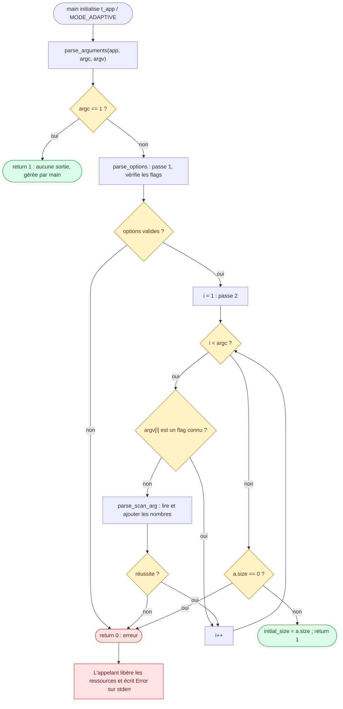
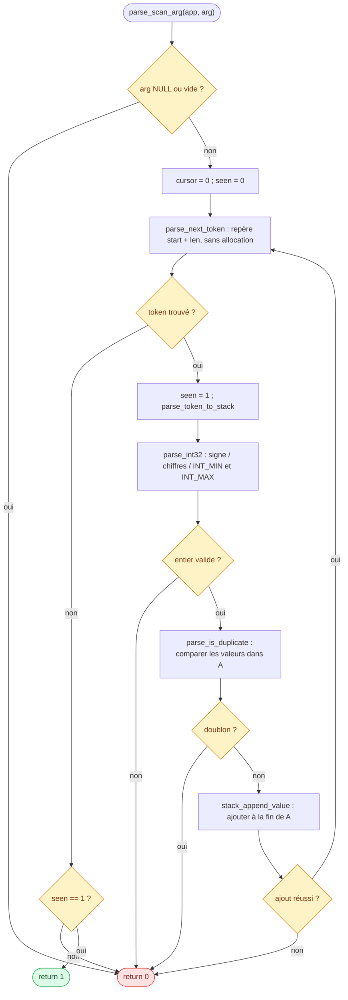

# Push_swap — Flowcharts du parsing (référence v1.2)

Ces schémas suivent les **six fichiers C de référence** (`src/parsing/*.c`).
Ils sont rendus directement par GitHub (Mermaid) : ce fichier `.md` est autonome.

## 1. Vue d'ensemble : les deux passes sur `argv`

## 2. Zoom : parcours d'un argument et de ses nombres

## 3. Exemple à suivre à la main

`./push_swap --bench --medium "42 -10" 7`

- **Passe 1** : `parse_options()` enregistre `mode = MODE_MEDIUM`, `bench = 1`.
- **Passe 2** : les deux flags connus sont sautés ; `"42 -10"` fournit deux tokens (`42`, `-10`) ; `7` fournit un token.
- Chaque token est converti, vérifié contre les doublons, puis ajouté à la **fin** de A.
- Résultat : `A = [42, -10, 7]` (sommet à gauche), `A.size = 3`, `initial_size = 3`, `B` reste vide.
- Pas de tri, de rangs ni d'opérations écrites pendant le parsing.

## 4. Erreurs et responsabilités

Un flag inconnu `--...` ou un mode répété est rejeté par la première passe ; un argument vide, un nombre invalide, un dépassement d'entier, un doublon, une allocation échouée ou l'absence de nombres après des flags font renvoyer **0** à `parse_arguments()`.

**Important :** le parsing **ne libère pas** lui-même les nœuds déjà insérés et **n'imprime rien**. Le code appelant doit nettoyer la mémoire et afficher `Error\n` sur `stderr`. S'il n'y a aucun argument (`argc == 1`), le parsing renvoie **1**, et le `main` doit se terminer sans rien afficher.

## 5. Correspondance avec les fichiers

| Fonction | Fichier |
|---|---|
| `parse_arguments` | `parse_arguments.c` |
| `parse_options`, `parse_flag_kind` | `parse_options.c` |
| `parse_scan_arg`, `parse_next_token` | `parse_tokens.c` |
| `parse_token_to_stack` | `parse_build_a.c` |
| `parse_int32` | `parse_int.c` |
| `parse_is_duplicate` | `parse_unique.c` |
| `stack_append_value` | `stack/` du binôme (hors parsing) |

## 6. Images pleine résolution

- `PUSH_SWAP_FLOWCHART_PARSING_GLOBAL.png` ou `.svg` : vue d'ensemble.
- `PUSH_SWAP_FLOWCHART_PARSING_TOKEN.png` ou `.svg` : détail d'un argument.
